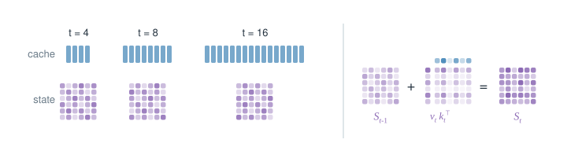
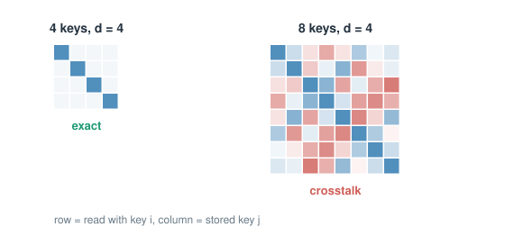
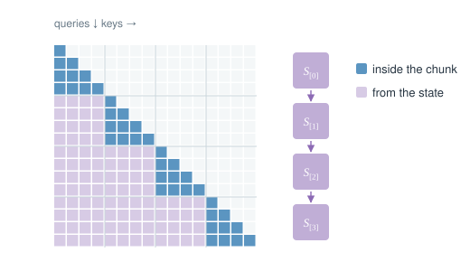
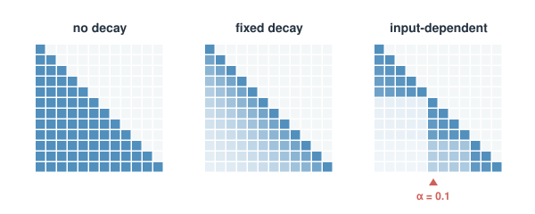
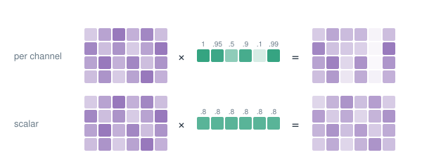
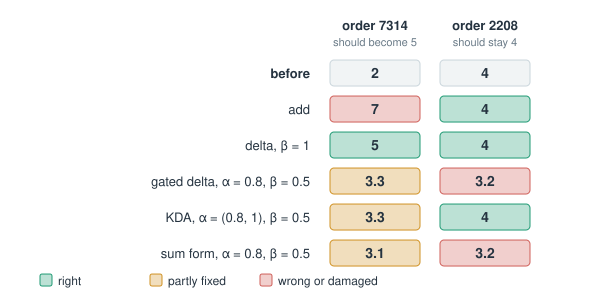
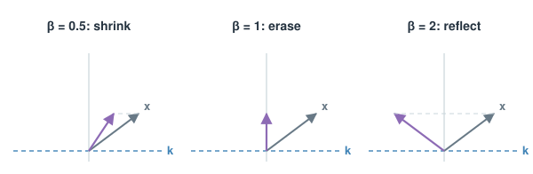
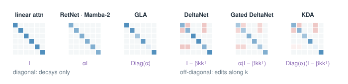
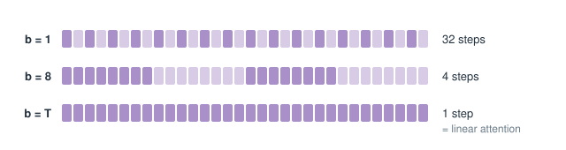
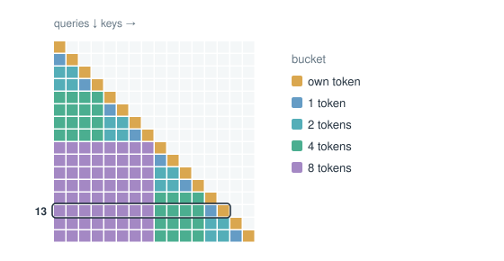

# Fixed-Size States: How the Mechanisms Work

This is a closer look at Part 4 of *Cheaper Attention on KV Cache*. The essay gives only the basic idea of each mechanism. Here every mechanism gets its steps, a worked number and a picture.

**Notation.** Per head, a query $q_t$ and a key $k_t$ have $d_k$ numbers, and a value $v_t$ has $d_v$ numbers. Keys and queries are normalized to length 1. The **state** $S_t$ is a $d_v\times d_k$ matrix. Every mechanism below has the same read, $o_t=S_tq_t$, and differs only in the **write**: how $S$ changes when a new token arrives.

## 1. Linear attention: a lookup table stored as a matrix

### 1.1 From the cache to the state

Softmax attention weighs every past value by $\exp(q_t^{\top}k_j)$, and the weights must be normalized over all past tokens, so every key and value has to be kept. Drop the softmax, and the weight is just the score $k_j^{\top}q_t$. Matrix products can then be regrouped:
$$
o_t=\sum_{j\le t}v_j\,(k_j^{\top}q_t)=\Big(\sum_{j\le t}v_jk_j^{\top}\Big)q_t=S_t\,q_t
$$
The bracket does not depend on the query, so it can be kept up to date token by token:

1. **Write:** when token $t$ arrives, add the outer product of its value and key, $S_t=S_{t-1}+v_tk_t^{\top}$.
2. **Read:** multiply the state with the query, $o_t=S_tq_t$.
3. **Discard:** $k_t$ and $v_t$ are not needed any more. They live inside $S_t$.

For a head width of 128, the state holds $128\times128=16{,}384$ numbers whatever the length. A KV cache holds $2\cdot N\cdot128$ numbers per head, so it passes the state after only 64 tokens and is 2,048× larger at 128K tokens. Every decode step reads the same fixed matrix.

### 1.2 What the state remembers

The state is a **lookup table from keys to values**, stored as one matrix. To see how well the lookup works, read it with one of the stored keys, $k_i$:
$$
S\,k_i=\sum_j v_j\,(k_j^{\top}k_i)=\underbrace{v_i}_{\text{wanted}}+\underbrace{\sum_{j\ne i}v_j\,(k_j^{\top}k_i)}_{\text{crosstalk}}
$$
If all keys are orthogonal, every $k_j^{\top}k_i$ with $j\ne i$ is zero, and the read returns exactly $v_i$. But a $d_k$-dimensional space has room for only $d_k$ orthogonal directions. After that, keys must overlap, and every read mixes in a little of every overlapping value.

So a $d_v\times d_k$ state can hold only about $d_k$ key–value pairs exactly. A KV cache holds all $N$. This one fact drives everything else in this file: the later mechanisms try to keep the table clean, but none of them makes it larger.

### 1.3 What the softmax was doing

Dropping the softmax looks like a small change, but the softmax did two jobs.

1. **Sharp focus.** The exponential lets one key win clearly. With scores 5 and 3, softmax gives the first key $e^5/e^3\approx7.4\times$ the weight of the second. A plain linear score gives only $5/3\approx1.7\times$. Many slightly matching keys add up and can drown the one right key.
2. **Weights that sum to 1.** Without the normalization, the size of the output drifts as more tokens are added to the state, which makes training unstable.

The first version (Linear Transformer, 2020) replaced $\exp(q^{\top}k)$ with $\phi(q)^{\top}\phi(k)$, using a positive feature map $\phi(x)=\operatorname{elu}(x)+1$, and kept a normalizer to divide by. Later versions dropped the normalizer because it made gradients unstable. They normalize $q$ and $k$ to length 1 and add a normalization layer on the output instead.

Note that this is a different model, not a faster way to compute softmax attention. A model trained with softmax cannot switch. It has to be trained with linear attention from the start.

### 1.4 Three ways to compute the same thing

The same layer can be computed in three ways, and all three give exactly the same outputs.

- **Parallel:** $O=(QK^{\top}\odot M)V$ with a causal mask $M$. It is fully parallel, but the cost grows as $N^2d$, which is what we wanted to avoid.
- **Recurrent:** the token-by-token loop of 1.1. The cost grows only as $Nd^2$, but every step waits for the previous one, which wastes a GPU during training and prefill.
- **Chunkwise:** a mix of both, and the form used in practice for training and prefill.

The chunkwise form cuts the sequence into chunks of $C$ tokens, usually 64 to 256:

1. **Inside a chunk,** compute the parallel form on the small $C\times C$ block, $(Q_{[c]}K_{[c]}^{\top}\odot M)V_{[c]}$.
2. **For all earlier chunks,** read the state passed in from the previous chunk, $Q_{[c]}S_{[c-1]}^{\top}$, and add it.
3. **Update the state once per chunk:** $S_{[c]}=S_{[c-1]}+V_{[c]}^{\top}K_{[c]}$.

All three steps are matrix products. For one head with $d=128$, $C=64$ and $N=32$K, the chunkwise form costs about 98,304 FLOPs per token in 512 sequential steps. The recurrent loop costs 65,536 FLOPs per token, but in 32,768 sequential steps. The quadratic form costs 8.4M FLOPs per token. Decode then uses the recurrent loop, one token at a time.

*Problems left over:* the state only adds. Nothing is ever forgotten or overwritten, so after many tokens the table is full of overlapping entries and every read is mostly crosstalk.

## 2. Forgetting: decay the state

### 2.1 One rule, one mask

The simplest fix is to let the state fade a little before each write:
$$
S_t=\alpha_t\,S_{t-1}+v_tk_t^{\top},\qquad 0<\alpha_t\le1
$$
Unrolled, a token $j$ that was written earlier has been multiplied by every decay since then. So the output is attention without the softmax, with a weight mask $D$:
$$
o_t=\sum_{j\le t}\Big(\prod_{s=j+1}^{t}\alpha_s\Big)(k_j^{\top}q_t)\,v_j
\qquad\Longleftrightarrow\qquad
O=(QK^{\top}\odot D)V,\quad D_{tj}=\prod_{s=j+1}^{t}\alpha_s
$$
The decay mask $D$ also tells the model how far away each token is, so these layers usually need no other positional encoding.

### 2.2 A fixed decay per head

**RetNet** (2023) uses one fixed decay $\gamma$ per head, so $D_{tj}=\gamma^{\,t-j}$ and old tokens fade at a set rate. A head remembers roughly the last $1/(1-\gamma)$ tokens. For example, with $\gamma=0.99$ the horizon is about 100 tokens, and a token 100 steps back keeps $0.99^{100}\approx0.37$ of its weight. Different heads get different decays, so the heads together cover several scales. RetNet's experiments space $1-\gamma$ from $1/32$ to $1/512$, so the horizons run from about 32 to 512 tokens. **Lightning attention** (2025) keeps this fixed decay and adds a fast kernel.

The price is that the decay ignores content. An important number and a greeting fade at exactly the same rate.

### 2.3 A decay chosen by the input

The next step is to let each token decide how much to forget.

**Mamba-2** (2024) uses one decay per head that depends on the token: $a_t=e^{\Delta_tA_h}$ with $A_h<0$, where $\Delta_t$ is computed from the input. Its paper shows that this state-space model is the same computation as the masked linear attention above, under a simple dictionary: the SSM input $x$ plays the value, $B$ plays the key and $C$ plays the query. This is called the **state-space duality**. Because the decay is one scalar per head, the whole layer runs as matrix products, reported 2–8× faster than the scan of the first Mamba. One catch is that $\Delta_t$ sets both the decay and the write strength, so a strong write also forgets more.

**GLA** (Gated Linear Attention, 2023) goes finer and decays each **key channel** separately:
$$
S_t=S_{t-1}\operatorname{Diag}(\alpha_t)+v_tk_t^{\top},\qquad \alpha_t=\sigma(W_\alpha x_t+b)^{1/16}\in(0,1)^{d_k}
$$
So one channel can be cleared at a topic switch while the others are kept.

The power $1/16$ keeps the decays close to 1, so by default the state forgets slowly. It maps sigmoid outputs of 0.01, 0.1, 0.5 and 0.9 to decays of 0.75, 0.866, 0.958 and 0.993. A diagonal decay still trains well in chunks, because the products of decays become sums in log space.

### 2.4 Mamba-3

**Mamba-3** (2026) changes the write in three ways:

1. **Trapezoid write:** each write averages the inputs at both ends of the step. With a toy step of 0.5 and decay 0.8, Mamba-2 writes 0.5 of $x_t$, while the trapezoid rule writes 0.2 of $x_{t-1}$ and 0.25 of $x_t$.
2. **Rotations:** a complex-valued state turns the real decay into a decay plus a rotation, which works like a position encoding that depends on the data.
3. **MIMO:** writes of rank 4 instead of rank 1 do about 4× the work on the same state. Decode is limited by bytes, not compute, so the reported latency stays about flat.

*Problems left over:* decay fades everything a little. It cannot remove one wrong association and keep the rest, and a scalar decay also fades memories that were still correct.

## 3. Correcting: the delta rule

### 3.1 Read, compare, overwrite

**DeltaNet** (2021, with a parallel training method in 2024) checks the table before writing:

1. **Read** what the state currently returns for the new key: $\hat v_t=S_{t-1}k_t$.
2. **Compare** it with the new value: the error is $v_t-\hat v_t$.
3. **Write only the error**, scaled by a strength $\beta_t\in(0,1)$:
   $$
   S_t=S_{t-1}+\beta_t\,(v_t-S_{t-1}k_t)\,k_t^{\top}=S_{t-1}\big(I-\beta_tk_tk_t^{\top}\big)+\beta_tv_tk_t^{\top}
   $$

If the state already holds the right value, the error is zero and nothing changes. If it holds a stale value, that value is replaced.

Take a toy example. The state maps two order numbers to a shipping day, with one key direction per order: order 7314 → 2 (Tuesday) and order 2208 → 4. Now a new fact arrives: order 7314 now ships on day 5 (Friday).

- **Linear attention** adds 5 on top of 2 and returns 7, a mix of the old and the new answer.
- **DeltaNet** reads 2, finds an error of 3, and with $\beta=1$ writes 3, so the state returns exactly 5. With $\beta=0.5$ it moves halfway, to 3.5. Order 2208 stays at 4.

Note that the edit is clean only along the key that was written. A query that overlaps that key also sees the change: a query halfway between the two order keys reads $4.24$ before the update and $6.36$ after.

### 3.2 The geometry of $I-\beta kk^{\top}$

The transition $I-\beta_tk_tk_t^{\top}$ leaves every direction except $k_t$ untouched. Along $k_t$ it multiplies by $1-\beta_t$, so its eigenvalues are $\{1,\dots,1,\ 1-\beta_t\}$.

- With $\beta$ between 0 and 1, the old entry along $k$ is shrunk.
- With $\beta=1$, it is erased completely, and the write puts in the new value.
- With $\beta=2$, it is flipped. This is a reflection, and it matters for state tracking (3.6).

### 3.3 Gated DeltaNet: decay first, then correct

**Gated DeltaNet** (2024) combines both tools:
$$
S_t=\alpha_t\,S_{t-1}\big(I-\beta_tk_tk_t^{\top}\big)+\beta_tv_tk_t^{\top}
$$
The decay $\alpha_t$ can clear a whole head at once, and the delta step edits a single association. Mamba-2 had only the first tool and DeltaNet only the second. The order matters: the state fades first, so the error is read from the faded state. In the toy with $\alpha=0.8$ and $\beta=0.5$, the state fades from (2, 4) to (1.6, 3.2). The read is 1.6, the error is 3.4, the write adds 1.7, and the result is (3.3, 3.2). The price is that a scalar decay also fades the unrelated order 2208, from 4 to 3.2.

### 3.4 KDA: per-channel decay inside the delta rule

**KDA** (Kimi Delta Attention, 2025) puts GLA's per-channel decay into the gated delta rule:
$$
S_t=S_{t-1}\operatorname{Diag}(\alpha_t)\big(I-\beta_tk_tk_t^{\top}\big)+\beta_tv_tk_t^{\top},\qquad \alpha_t\in(0,1)^{d_k}
$$
In the toy with $\alpha=(0.8,1)$ and $\beta=0.5$, only order 7314's channel fades. The result is (3.3, 4): order 2208 is kept. KDA's speed trick is that both low-rank vectors in its transition are tied to $k_t$, which is reported to make its kernels about 2× faster than a general diagonal-plus-low-rank transition.

### 3.5 The sum form

**RWKV-7** and **Comba** (2025) write the same idea as a sum instead of a product. The decay and the erase are both applied to the old state, so the erase reads the **unfaded** value. In the toy, the erase reads 2 instead of 1.6 and removes 1.0 instead of 0.8, and the result is (3.1, 3.2) instead of (3.3, 3.2). RWKV-7 also makes the decay and the write strength vectors over key channels. Its removal key differs from its write key, so its transition is a general diagonal-plus-low-rank matrix, which costs about twice KDA's work per chunk.

### 3.6 Negative eigenvalues and state tracking

Some tasks need the state to **track** something, not just remember it. The simplest is parity: is the number of 1-bits so far even or odd? A linear RNN whose transition has only positive eigenvalues provably cannot solve parity in finite precision. The state can only shrink or stay the same, never flip.

The fix is to let $\beta$ go up to 2, for example $\beta=2\sigma(\cdot)$. Then the eigenvalue $1-\beta$ reaches $-1$, a reflection. On the bits 1 0 1 1 0 1, a one-number state that flips its sign at every 1-bit ends at +1, correctly showing an even count. **DeltaProduct** (2025) goes further and takes several delta steps per token. Two reflections make a rotation, for example two mirrors 30° apart give a 60° rotation, and the state does not grow.

Note that this adds expressivity, not capacity. The state can track more kinds of structure, but it still holds about $d_k$ exact pairs.

### 3.7 Training the delta rule

For a decay alone, a chunk only needs cumulative products of decays. The delta rule's transitions $I-\beta kk^{\top}$ do not commute, so the product of a chunk's transitions is rewritten in a compact WY or UT form before the matrix products.

*Problems left over:* the delta rule keeps the table clean, but the table is still $d_v\times d_k$. A better write cannot add room.

## 4. One axis: the transition matrix

Every rule so far has the same shape:
$$
S_t=S_{t-1}A_t+W_t
$$
Here $W_t$ is the write, almost always a scaled $v_tk_t^{\top}$. $A_t$ is the **transition**: what happens to the old state before the write. The methods differ almost only in $A_t$.

| $A_t$ | Methods | What it can do | How a chunk is trained |
| --- | --- | --- | --- |
| $I$ | linear attention | nothing, only adds | plain sums |
| $\gamma I$, $\alpha_tI$ | RetNet, Lightning, Mamba-2 | fade everything | cumulative product |
| $\operatorname{Diag}(\alpha_t)$ | GLA | fade each key channel | cumulative sum in log space |
| $I-\beta kk^{\top}$ | DeltaNet | overwrite along $k$ | WY / UT form |
| $\alpha_t(I-\beta kk^{\top})$ | Gated DeltaNet | fade, then overwrite | WY / UT form |
| $\operatorname{Diag}(\alpha_t)(I-\beta kk^{\top})$ | KDA | fade per channel, then overwrite | WY / UT form |
| $\operatorname{diag}(w)-\hat\kappa(a\odot\hat\kappa)^{\top}$ | RWKV-7, Comba | the sum form | general diagonal + low rank |
| products of reflections, rotations | DeltaProduct, Mamba-3 | track structure such as parity | per sub-step; rotations |

Diagonal transitions commute with each other, so a chunk needs only cumulative decays. Householder-like transitions do not, so they need the WY/UT rewrite.

The 2026 research models refine the delta rule along the same axis. They separate *how strongly* to erase, *how strongly* to write and *where* to erase: per-channel erase and write gates, an erase direction separate from the write key, or a step size set by an uncertainty estimate. None of them changes the size of the state.

## 5. The state as a small model trained while reading

### 5.1 Every write is one learning step

There is a second way to read all these rules. Think of $S$ as the weights of a small linear model that should map keys to values. Each write is then **one gradient step** on a loss for the newest pair:
$$
S_t=\alpha_tS_{t-1}-\beta_t\,\nabla_S\,\ell_t\big(\alpha_tS_{t-1}\big)
$$

| Rule | Loss $\ell_t(S)$ | Gradient | Decay |
| --- | --- | --- | --- |
| Linear attention | $-\langle Sk_t,v_t\rangle$ | $-v_tk_t^{\top}$ | 1 |
| RetNet, Mamba-2 | $-\langle Sk_t,v_t\rangle$ | $-v_tk_t^{\top}$ | scalar < 1 |
| DeltaNet | $\tfrac12\lVert Sk_t-v_t\rVert^2$ | $(Sk_t-v_t)k_t^{\top}$ | 1 |
| Gated DeltaNet | $\tfrac12\lVert Sk_t-v_t\rVert^2$ | $(Sk_t-v_t)k_t^{\top}$ | scalar < 1 |

Linear attention and DeltaNet differ only in the loss, and the decay acts as **weight decay**. Take a toy with $d=3$ and $\beta=1$. The state maps $e_1\to e_1$ and $e_2\to e_2$, and the new pair is $e_1\to e_3$. The linear-attention step then reads back $(1,0,1)$, keeping the old value, with an error of 1. The delta step reads back exactly $(0,0,1)$, with an error of 0.

This view suggests the next moves: a richer model, a better optimizer, or a better loss.

### 5.2 TTT: the state is a model, trained in mini-batches

**TTT layers** (2024) make the state a model $f(\cdot\,;W)$, either linear or a small MLP, and train it on each token with a gradient step:
$$
W_t=W_{t-1}-\eta_t\nabla_W\big\lVert f(\theta_Kx_t;W)-\theta_Vx_t\big\rVert^2,\qquad z_t=f(\theta_Qx_t;W_t)
$$
Updating after every token is slow, so TTT updates in **mini-batches** of $b$ tokens. All the gradients in a batch use the weights from the start of the batch, so $b$ gradients run as one matrix product.

With $b=1$ this is online learning, close to the delta rule. With $b=T$, a linear $f$, step size ½ and zero start weights, it is exactly linear attention. TTT uses $b=16$. In the reported 125M ablation, perplexity falls from 15.91 for linear attention to 11.09, and the mini-batch step alone is the largest single gain, −1.70.

### 5.3 Titans: surprise, momentum and forgetting

**Titans** (2024) adds two optimizer ideas to the memory update:
$$
\mathcal M_t=(1-\alpha_t)\,\mathcal M_{t-1}+m_t,\qquad m_t=\eta_t\,m_{t-1}-\theta_t\,\nabla\big\lVert\mathcal M_{t-1}(k_t)-v_t\big\rVert^2
$$

1. **Surprise:** the gradient is large when the memory's prediction is wrong, so surprising tokens get written strongly.
2. **Momentum:** $m_t$ keeps writing for a few tokens after a surprise, so the context around a surprising token is stored too.
3. **Forgetting:** $\alpha_t$ acts as weight decay. In the reported ablation, removing it costs the most, raising perplexity from 27.01 to 29.04.

The memory $\mathcal M$ is a deep MLP. The price is that a deep memory loses the neat chunk algebra, so it trains slower than Mamba-2 or Gated DeltaNet.

### 5.4 ATLAS and Mesa: fit more than the newest pair

The delta rule fits only the newest pair. Two 2025 methods fit more:

- **ATLAS** optimizes the memory on a window of the last $c$ pairs, with the Muon optimizer and polynomial features that raise the capacity bound from $O(d_k)$ to $O(d_k^{\,p})$.
- **Mesa** solves the least-squares problem over all pairs exactly at read time: $o_t=G_t(H_t+\Lambda)^{-1}q_t$, where $G_t$ sums $v_tk_t^{\top}$ and $H_t$ sums $k_tk_t^{\top}$.

With two correlated keys, $k_1=(1,0)\to+1$ and $k_2=(0.6,0.8)\to-1$, reading at $k_1$ gives 0.40 for linear attention, 0.04 for DeltaNet and 1.00 for Mesa. The price is compute: with $k$ conjugate-gradient steps, Mesa costs about $k$ times GLA.

### 5.5 LaCT: huge chunks make it fast

Small mini-batches leave the GPU idle. With $b=16$ and width 64, a TTT update reaches only about 11 FLOPs per byte, far below the roughly 290 an H100 needs. **LaCT** (2025) updates only once per 2K to 1M tokens, so each update is a big matrix product. It reports up to 70% GPU use, against under 5% for earlier TTT, and its state can grow far larger. Because a chunk never sees its own update, every LaCT layer is paired with sliding-window attention for the local part.

| Layer | Loss | Optimizer | State |
| --- | --- | --- | --- |
| TTT-Linear / MLP | $\lVert f(\theta_Kx)-\theta_Vx\rVert^2$ | GD, mini-batch $b=16$ | linear map or 2-layer MLP |
| Titans | $\lVert\mathcal M(k)-v\rVert^2$ | GD + momentum + decay | MLP |
| ATLAS | last $c$ pairs, polynomial features | Muon | memory on $\phi(k)$ |
| Mesa | all pairs, discounted, ridge | exact solve (CG) | $G$ and $H$ |
| LaCT | $-f_W(k)^{\top}v$ | Muon, once per huge chunk | SwiGLU MLP |

## 6. Limits: learning is not recall

All of these improve **how** the table is written, but a fixed state still holds only about $d_k$ exact pairs per $d_v\times d_k$ state, while a KV cache keeps all $N$. The reported numbers show the gap. In one comparison of 1B models on in-context recall tasks, the best fixed-state layer (Mesa) scores 41.79, against 52.27 for a Transformer. Going from plain additive writes to an exact solve gains about 4 points, while keeping the full cache gains 10.5 more.

**Log-linear attention** (2025) is a middle ground. Instead of one state, it keeps one state per power-of-two **bucket** of the past, like a Fenwick tree:
$$
o_t=\sum_{\ell}\lambda_t^{(\ell)}S_t^{(\ell)}q_t,\qquad S_t^{(\ell)}=\sum_{s\in\mathcal B_t^{(\ell)}}v_sk_s^{\top}
$$

Recent tokens get small buckets, and far tokens are merged into big ones. At token 13 the buckets are tokens 0–7, 8–11 and 12, plus the token itself: 4 states. After about a million tokens ($2^{20}$), a KV cache holds 1,048,576 records, log-linear attention at most 22 states, and linear attention 1. The reported gains in perplexity are small, and the gap to Transformers remains.

So in practice, models keep a few full-attention layers for exact recall and make the rest fixed-state layers. That is the hybrid design of Part 5 of the essay.
