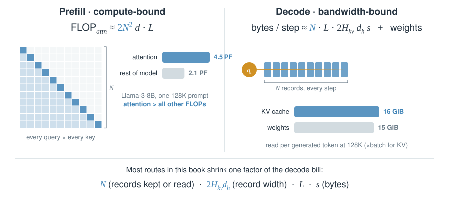
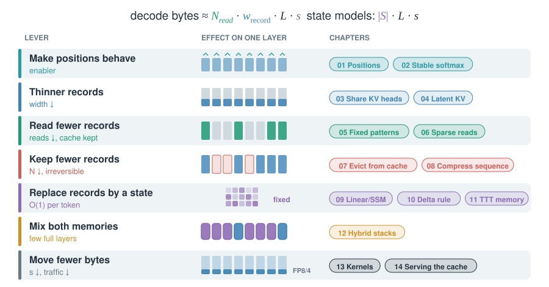
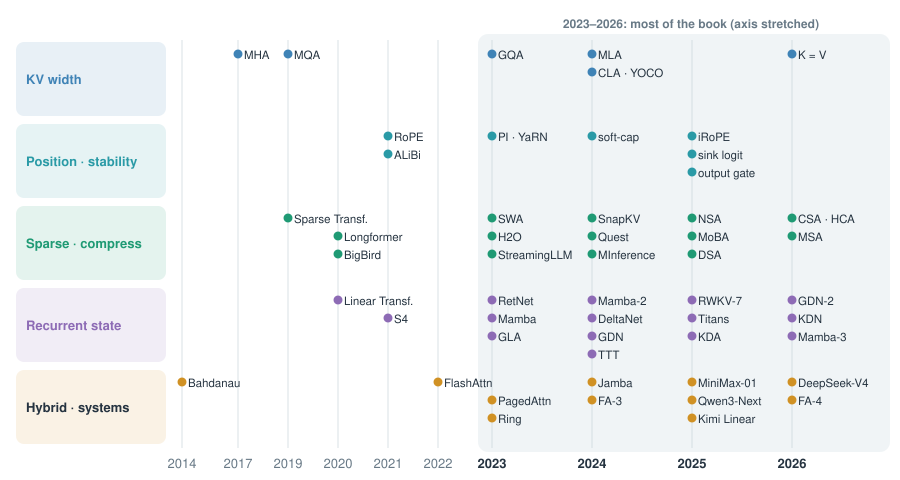
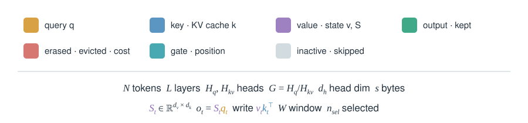

# 00 · The map

::: lede
Every mechanism in this book attacks one factor of the attention bill. Here are the bill, the levers, and when each lever appeared.
:::

## The bill: prefill pays $N^2$, decode pays $N$ bytes per token {#bill .insight}

$$
\text{FLOP}_{\text{prefill}}\approx 2N^2d\cdot L
\qquad
\text{bytes}_{\text{decode step}}\approx N\cdot L\cdot 2H_{kv}d_h\cdot s\;+\;\text{weights}
$$

::: tips
- **Two different walls.** Long prompts hit compute (prefill). Long generations and big batches hit HBM bandwidth (decode).
- **At 128K the cache outweighs the model.** Llama-3-8B reads more KV bytes than weight bytes per token.
- **Batch multiplies KV, not weights.** That is why serving cares about cache bytes first.
:::

::: {.more title="Where the numbers come from"}
Llama-3-8B: $L=32$, $H_q d_h = 4096$, $H_{kv}=8$, $d_h=128$, 8.03 B parameters, BF16. Causal prefill: $2N^2 d$ per layer $= 2\cdot 131072^2\cdot 4096\cdot 32 \approx 4.5\times10^{15}$. The rest of the model: $2\cdot 8.03\times10^9\cdot 131072\approx 2.1\times10^{15}$. KV: $32\cdot 2\cdot 8\cdot 128\cdot 2$ B $= 128$ KiB per token, times 131,072 = 16 GiB.
:::

## Seven levers {#levers .insight}

$$
\text{decode bytes}\approx \underbrace{N_{\text{read}}}_{\text{05–08}}\cdot\underbrace{w_{\text{record}}}_{\text{03–04}}\cdot L\cdot \underbrace{s}_{\text{13–14}}
\qquad\text{or}\qquad \underbrace{|S|\cdot L\cdot s}_{\text{09–12}}
$$

::: tips
- **Reads vs records.** Sparse reads (06) keep the cache and touch less. Eviction (07) and compression (08) shrink the cache itself.
- **State models change the formula.** Cost stops growing with $N$; capacity becomes the question (09–11).
- **Production stacks combine levers.** DeepSeek-V4: compressed records + top-k sparse reads + a local window + FP8 storage.
:::

## Twelve years in five lanes {#timeline .insight}

$$
\text{2014 Bahdanau}\;\to\;\text{2017 MHA}\;\to\;\text{2023 GQA, Mamba}\;\to\;\text{2024 MLA, GDN}\;\to\;\text{2025 NSA, DSA, KDA}\;\to\;\text{2026 CSA/HCA}
$$

::: tips
- **2023 was the turn.** GQA, sliding windows, H2O, RetNet, Mamba and PagedAttention all arrived in one year.
- **2025–26 is convergence.** Frontier models mix a few full-attention layers with sparse reads or recurrent state.
- **Each dot is a card.** Use the search box in the sidebar to jump to any name.
:::

## How to read the cards {#legend .insight}

$$
\text{card} = \text{meta line} + \text{one formula} + \text{one figure} + \text{2–4 tips}\;(+\text{optional derivation})
$$

::: tips
- **Colours never change meaning.** Gold is always a query, purple always a value or state.
- **Numbers are real unless marked "toy".** Real numbers come from papers, model cards or `config.json`. See [Primary sources](../bibliography/sources.md).
- **Click any figure** to open it full size.
:::
