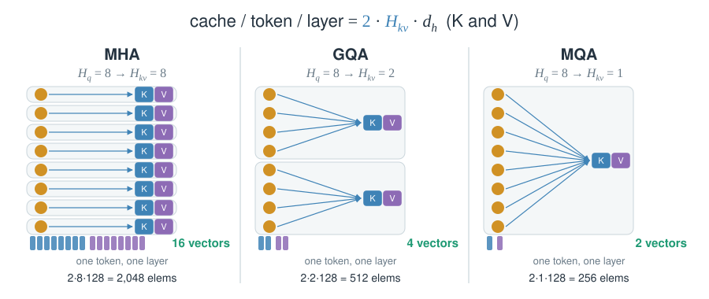
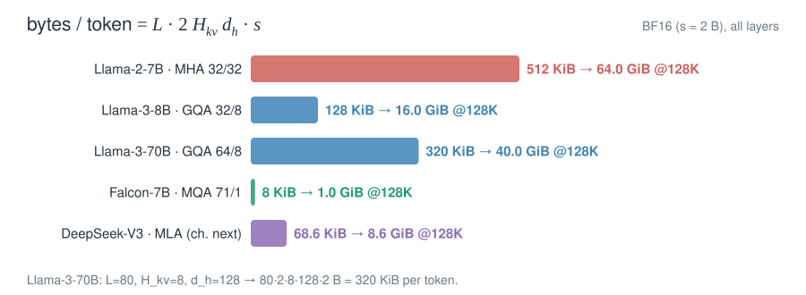
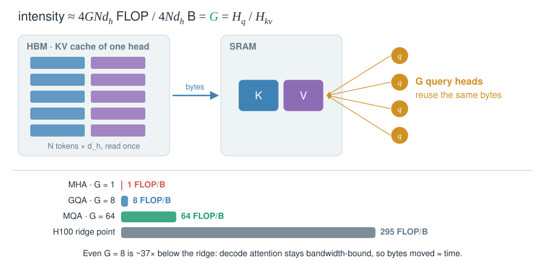

# 03 · Share KV heads

::: lede
Decode re-reads the whole cache for every new token. First lever: store fewer K/V heads per token and keep every query head.
:::

## MHA → GQA → MQA: one knob, $H_{kv}$ {#gqa}

::: meta
**MQA** 2019 · Shazeer, Google · [arXiv:1911.02150](https://arxiv.org/abs/1911.02150) — **GQA** 2023 · Ainslie et al., Google Research · EMNLP 2023 · [arXiv:2305.13245](https://arxiv.org/abs/2305.13245) · Used in: PaLM, Falcon-7B, Gemma-2B (MQA); Llama 2-70B, Llama 3, Mistral 7B, Qwen2/3 (GQA)
:::

$$
o_{t,i}=\sum_{j\le t}\operatorname{softmax}_j\!\Big(\frac{q_{t,i}^{\top}k_{j,g(i)}}{\sqrt{d_h}}\Big)\,v_{j,g(i)},
\qquad g(i)=\Big\lfloor \frac{i\,H_{kv}}{H_q}\Big\rfloor
$$

::: tips
- **Each query head keeps its own softmax.** Shared K/V does not mean shared attention patterns.
- **Quality:** uptrained GQA-8 lands close to MHA quality at near-MQA decode speed (reported, T5-XXL, GQA §4).
- **MHA → GQA conversion:** mean-pool each group's K/V projections, then uptrain for about 5% of the pre-training steps (GQA §2.1).
:::

## What it saves in real models {#numbers .insight}

$$
\text{KV bytes per token}=L\cdot 2H_{kv}d_h\cdot s
$$

::: tips
- **Read it off `config.json`:** `num_hidden_layers` × 2 × `num_key_value_heads` × `head_dim` × bytes.
- **Width, not length.** Sharing shrinks each record. The number of records still grows with $N$.
- **Batch multiplies it.** 32 concurrent 8K requests on Llama-3-70B need 80 GiB of KV in BF16.
:::

## Why decode benefits: intensity = group size {#intensity .insight}

$$
I=\frac{\text{FLOPs}}{\text{bytes}}\approx\frac{4\,G\,N d_h}{4\,N d_h}=G=\frac{H_q}{H_{kv}}
$$

::: tips
- **At decode, bytes moved ≈ time.** One KV byte feeds $G$ heads under GQA but only one under MHA.
- **Ridge point:** H100 SXM ≈ 989 TFLOP/s ÷ 3.35 TB/s ≈ 295 FLOP/B. Attention decode sits far left of it.
- **Tensor-parallel gotcha:** KV heads are split across GPUs. If $H_{kv}$ < TP degree, KV heads get replicated and the saving shrinks.
:::

::: {.more title="Where 4GNd_h comes from"}
Per query head: scores $q^\top k_j$ for $N$ keys cost $2Nd_h$ FLOPs, and the weighted sum $\sum_j p_j v_j$ another $2Nd_h$. A group of $G$ heads does $4GNd_h$. The group reads $N d_h$ key elements and $N d_h$ value elements once: $4Nd_h$ bytes in BF16.
:::

## K=V: one vector is both key and value {#kv-tie}

::: meta
**K=V** 2026 · Gemma Team, Google · [arXiv:2607.02770](https://arxiv.org/abs/2607.02770) — DeepSeek-AI · [arXiv:2606.19348](https://arxiv.org/abs/2606.19348) — study: Kayyam et al. · ICML 2026 · [arXiv:2606.04032](https://arxiv.org/abs/2606.04032) · Used in: Gemma 4 31B / 26B-A4B (global layers), DeepSeek-V4-Pro / Flash
:::

$$
u_j=W_K h_j,\qquad k_j=\operatorname{RoPE}_j\big(\operatorname{norm}_g(u_j)\big),\qquad v_j=\operatorname{norm}(u_j)
$$

::: tips
- **Why it works:** keys and values can share one subspace. Reported cost: +3.1% perplexity for −50% KV (Kayyam et al.).
- **Gotcha:** a rotated vector is a poor value. Gemma 4 never rotates $v$; DeepSeek-V4 rotates the output back by $-t$.
- **Numbers:** Gemma 4 reports −37.5% global KV, not −50%. V4 caches one 512-element entry per token (one KV head).
- **Intensity doubles:** the same bytes feed $q^\top k$ and $\sum_j p_j v_j$, so $I\approx 2G$ ([next card](#beyond-gqa)).
:::

## Beyond GQA: MFA, GTA, GLA {#beyond-gqa}

::: meta
**MFA** 2024 · Hu et al., StepFun · [arXiv:2412.19255](https://arxiv.org/abs/2412.19255), Step-3 [arXiv:2507.19427](https://arxiv.org/abs/2507.19427) — **GTA / GLA** 2025 · Zadouri, Strauss, Dao, Princeton · [arXiv:2505.21487](https://arxiv.org/abs/2505.21487) · Used in: Step-3 (MFA)
:::

$$
I\approx\frac{2G}{m},\qquad G=\frac{H_q}{\text{cached heads}},\qquad m=\begin{cases}2 & K\neq V\\ 1 & \text{tied or latent}\end{cases}
$$

::: tips
- **Lens:** MHA ≈ 1, GQA ≈ $G$, MQA ≈ $H_q$, MLA ≈ $2H_q$ (Zadouri et al., Table 1). Past the ridge, extra heads cost time.
- **MFA:** one K and one V head of 256 serve 64 query heads with a rank-2048 query. Step-3 (8-bit KV): MFA 128, MLA 512 FLOP/B.
- **GTA:** the tied state is the value; the key is its first half plus a shared RoPE half. Reported: GQA quality, about half the cache.
- **GLA:** two latent heads instead of one, so TP=2 duplicates nothing: 640 vs 1,152 B/token/device (Table 5).
:::

## Cross-layer sharing: fewer layers own a cache {#cross-layer}

::: meta
**CLA** 2024 · Brandon et al., MIT / IBM · NeurIPS 2024 · [arXiv:2405.12981](https://arxiv.org/abs/2405.12981) — **YOCO** 2024 · Sun et al., Microsoft / Tsinghua · NeurIPS 2024 · [arXiv:2405.05254](https://arxiv.org/abs/2405.05254) · Used in: Hunyuan-Large (CLA2), Gemma 3n, Gemma 4 E2B / E4B
:::

$$
K^{(\ell)},V^{(\ell)}\leftarrow K^{(\operatorname{src}(\ell))},V^{(\operatorname{src}(\ell))},\qquad \text{bytes/token}=\sum_{\ell\in\text{owners}}2H_{kv}d_h\,s
$$

![Layer strips showing which layers own a KV cache. CLA2 in Hunyuan-Large: every second of 64 layers reuses its neighbour, 32 caches; with GQA-8 about 5% of MHA. Gemma 3n E4B: layers 20–34 reuse layer 18 (local) or 19 (global), 20 of 35 layers own a cache, global KV 14 → 8 KiB per token, window caches 28 → 16 MiB. Gemma 4 E2B: layers 15–34 reuse layers 13 and 14, 15 of 35 own a cache, 14 → 6 KiB per token. YOCO: a self-decoder with window caches, then one global KV read by every cross-decoder layer; reported about 80× less KV at 65B. Prompt tokens can stop at the last owner layer.](../figures/cards/kv-cross-layer.svg)

::: tips
- **Storage, not reads:** every consumer layer still reads the shared cache.
- **Prefill wins:** consumer layers produce no KV, so prompt tokens exit early (YOCO). Gemma 3n reports 2× prefill vs Gemma 3 4B.
- **Train it in:** shared layers have no `k_proj`/`v_proj` (HF Gemma 4 code). Gemma 4 shares 20/35 (E2B) and 18/42 (E4B) layers.
- **Stacks:** Hunyuan-Large combines GQA-8 with CLA2: about 95% below MHA (reported).
:::
