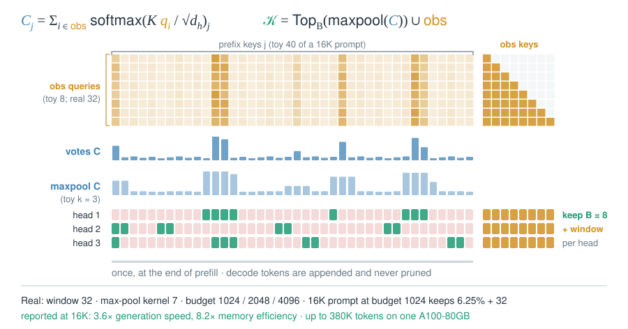

# 07 · Evict from the cache

::: lede
Selection reads fewer records but keeps them all. Eviction deletes records for good, so it must guess what future queries will need.
:::

## H2O: heavy hitters plus a recent window {#h2o}

::: meta
**H2O** 2023 · Zhang et al., UT Austin / Stanford / Meta / CMU · NeurIPS 2023 · [arXiv:2306.14048](https://arxiv.org/abs/2306.14048) · Used in: NVIDIA kvpress (ObservedAttentionPress); the standard eviction baseline
:::

$$
S_j \leftarrow S_j + a_{t,j},\qquad \mathcal{K}_t=\operatorname{Recent}_{B/2}(t)\,\cup\,\operatorname{Top}_{B/2}(S),\qquad j\notin\mathcal{K}_t\ \Rightarrow\ \text{evicted for good}
$$

::: tips
- **Why it works:** a few tokens collect most of the attention, and their accumulated score stays high across steps.
- **Gotcha:** it needs $a_{t,j}$ at every step. Fused FlashAttention kernels never write it out.
- **Gotcha:** early tokens have been summed for the most steps, so the score is biased toward the start of the context.
- **Numbers (reported):** 20% budget. Up to 29× throughput vs DeepSpeed and Accelerate, and 3× vs FlexGen, on OPT-6.7B/30B.
:::

## SnapKV: the prompt's tail votes once {#snapkv}

::: meta
**SnapKV** 2024 · Li et al., UIUC / Cohere · NeurIPS 2024 · [arXiv:2404.14469](https://arxiv.org/abs/2404.14469) · Used in: NVIDIA kvpress (SnapKVPress); the scorer behind PyramidKV and Ada-KV
:::

$$
C_j=\sum_{i\in\text{obs}}\operatorname{softmax}\!\Big(\frac{K q_i}{\sqrt{d_h}}\Big)_j,\qquad \mathcal{K}^{(h)}=\operatorname{Top}_B\big(\operatorname{maxpool}_7(C)\big)\cup\text{obs}
$$

::: tips
- **Once, after prefill:** generated tokens are appended and never pruned, so long outputs still grow the cache.
- **Why pool:** max-pooling also keeps the neighbours of a hit, so a multi-token string such as "order 7314" survives whole.
- **Gotcha:** the votes come from the prompt's last 32 tokens. If the real question arrives later, the wrong tokens voted.
- **Numbers (reported):** 3.6× faster generation and 8.2× better memory efficiency at 16K. Up to 380K tokens fit on one A100-80GB.
:::

## PyramidKV and Ada-KV: where the budget goes {#budgets}

::: meta
**PyramidKV** 2024 · Cai et al., UW–Madison / PKU / Microsoft · [arXiv:2406.02069](https://arxiv.org/abs/2406.02069) — **Ada-KV** 2024 · Feng et al., USTC · NeurIPS 2025 · [arXiv:2407.11550](https://arxiv.org/abs/2407.11550) · Used in: NVIDIA kvpress (PyramidKVPress, AdaKVPress)
:::

$$
\begin{aligned}
\text{PyramidKV:}\quad & k^{\ell}=k^{0}-\tfrac{\ell}{L-1}\big(k^{0}-k^{L-1}\big),\qquad k^{L-1}=\tfrac{k_{\text{tot}}}{\beta L},\qquad k^{0}=\tfrac{2k_{\text{tot}}}{L}-k^{L-1}\\
\text{Ada-KV:}\quad & B_h=\#\big\{\text{entries of head } h \text{ in } \operatorname{Top}_{B}\big(C^{(1)},\dots,C^{(H)}\big)\big\}
\end{aligned}
$$

::: tips
- **Allocation, not scoring:** both reuse SnapKV's window scores. Only the share each layer or head gets changes.
- **Why a pyramid:** attention is spread wide in lower layers and concentrated in upper layers, so upper layers need fewer entries.
- **Why per head:** Ada-KV bounds the output error by the attention mass it drops. A pooled Top-B drops the least mass.
- **Numbers (reported):** PyramidKV matches full KV on LongBench with 12% of the cache. With 128 entries, LLaMA-3-70B scores 100.0 on Needle.
:::

## KVzip: keep what the model needs to repeat the context {#kvzip}

::: meta
**KVzip** 2025 · Kim et al., Seoul National University / NAVER AI Lab · NeurIPS 2025 (oral) · [arXiv:2505.23416](https://arxiv.org/abs/2505.23416) · Used in: NVIDIA kvpress (KVzipPress)
:::

$$
s_j=\max_{g\le G,\;i\in\text{repeat}} a^{(g)}_{i,j},\qquad \mathcal{K}=\operatorname{Top}_{r\%}\big(s\ \text{over all KV heads}\big)
$$

::: tips
- **Query-agnostic:** the prompt "Repeat the previous context:" stands in for every future question, so one pruned cache serves many queries.
- **Cost:** one extra pass over the context in 2K-token chunks, which adds roughly one more prefill's worth of causal attention.
- **Compare:** the authors report that query-aware eviction degrades in multi-query use even at a 90% budget.
- **GQA:** the max runs over the $G$ query heads of each KV head, so a shared KV pair is scored once.
:::

## DuoAttention and RazorAttention: evict per head {#duo}

::: meta
**RazorAttention** 2024 · Tang et al., Huawei · ICLR 2025 · [arXiv:2407.15891](https://arxiv.org/abs/2407.15891) — **DuoAttention** 2024 · Xiao et al., MIT / NVIDIA · ICLR 2025 · [arXiv:2410.10819](https://arxiv.org/abs/2410.10819) · Used in: NVIDIA kvpress (DuoAttentionPress)
:::

$$
o_h=\alpha_h\,\operatorname{Attn}_{\text{full}}+(1-\alpha_h)\,\operatorname{Attn}_{\text{sink+recent}},\qquad \mathcal{L}=\lVert h_{\text{full}}-h_{\alpha}\rVert_2^2+\lambda\lVert\alpha\rVert_1,\ \ \lambda=0.05
$$

::: tips
- **Static, per head:** decided once offline, so decode needs no scorer and keeps standard kernels (unlike H2O).
- **Gotcha:** under GQA a "head" is a KV head. Llama-3-8B needs 50% retrieval heads, while MHA Llama-2-7B needs 25%.
- **Streaming head:** a per-head [StreamingLLM](05-fixed-patterns.md#streaming) cache. A trained [sink logit](02-stable-softmax.md#sinks) removes the need to store sink tokens.
- **RazorAttention:** training-free choice of heads. It folds dropped tokens into one compensation token and reports over 70% KV reduction.
:::

## DMC → DMS: learn what to merge or evict {#dms}

::: meta
**DMC** 2024 · Nawrot et al., NVIDIA / University of Edinburgh · ICML 2024 · [arXiv:2403.09636](https://arxiv.org/abs/2403.09636) — **DMS** 2025 · Łańcucki et al., NVIDIA / University of Edinburgh · NeurIPS 2025 · [arXiv:2506.05345](https://arxiv.org/abs/2506.05345) · Used in: NVIDIA checkpoints Llama-2-7B/13B-DMC-4x/8x, Qwen3-8B-DMS-8x
:::

$$
\begin{aligned}
\text{DMC:}\quad & \alpha_t=1:\ k_{\text{last}}\leftarrow\frac{z\,k_{\text{last}}+\omega_t k_t}{z+\omega_t},\ \ z\leftarrow z+\omega_t;\qquad \alpha_t=0:\ \text{append } k_t\\
\text{DMS:}\quad & \alpha_t=1\ \Rightarrow\ \text{evict } (k_t,v_t) \text{ at step } t+w
\end{aligned}
$$

::: tips
- **No new parameters:** $\alpha_t$ and DMC's $\omega_t$ come from repurposed neurons of $q_t$ or $k_t$. Values are merged the same way as keys.
- **Why delay:** during the $w$ steps before eviction, later tokens can still read the entry and absorb what it holds.
- **Cost:** to reach 8×, DMC needs about 44K training steps and DMS about 1K, using logit distillation from the original model.
- **Hyper-scaling:** the same KV reads buy longer reasoning traces. DMS reports higher AIME 24, GPQA and LiveCodeBench scores on Qwen-R1.
:::

## Pitfalls: eviction cannot be undone {#pitfalls .insight}

$$
\mathcal{E}_t\subseteq\mathcal{E}_{t+1},\qquad \text{a query at step } t \text{ can use token } j \text{ only if } j\notin\mathcal{E}_t
$$

::: tips
- **Not solved:** [selection](06-sparse-reads.md) can choose again for each query, but eviction cannot. Always score the queries that arrive after compression.
- **Gotcha:** if the question is still in the compressed prompt, SnapKV-style scorers look better than they are (NVIDIA kvpress README).
- **Gotcha:** instructions fade unevenly, and system-prompt leakage rises under compression (ACL 2026).
- **Stacks with:** [KV quantization](14-serving.md) keeps every record and cuts bytes per record.
:::

| Mechanism | Decided | Unit | Runtime scorer | Training |
| --- | --- | --- | --- | --- |
| H2O | every decode step | token, per head | attention probabilities | none |
| SnapKV (+ PyramidKV, Ada-KV) | once, end of prefill | token, per head | last 32 queries × N | none |
| KVzip | once per context | token, pooled over heads | one extra pass | none |
| DuoAttention | offline, per model | head | none | gates only, 2K steps |
| DMS | every step, learned | token, per head | one reused neuron | ≈1K-step retrofit |
