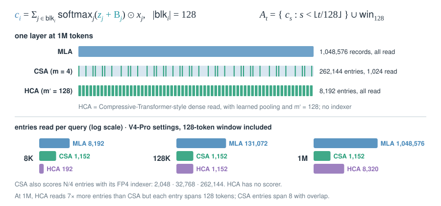

# 08 · Compress the sequence

::: lede
Eviction deletes positions. Compression merges each run of m tokens into one learned record, so the cache grows as N/m instead of N.
:::

## Compressive Transformer: pool old memories, don't drop them {#compressive}

::: meta
**Compressive Transformer** 2019 · Rae et al., DeepMind · ICLR 2020 · [arXiv:1911.05507](https://arxiv.org/abs/1911.05507) · Used in: research only; the ancestor of the HCA idea, and the paper that introduced PG-19
:::

$$
\text{cm}\leftarrow f_c\big(m_{\text{oldest }n_s}\big)\in\mathbb{R}^{\lfloor n_s/c\rfloor\times d},\qquad \text{range}=L\,(n_m+c\,n_{cm})
$$

::: tips
- **Why it works:** pooling old memories at rate $c$ instead of dropping them lets a fixed slot budget cover $c$ times more history.
- **Compare:** it reads every pooled record densely, like [HCA](#hca), with no top-k selection, unlike [CSA](#csa).
- **Converts from:** the "most-used" $f_c$ keeps the most-attended memories, which is [H2O](07-kv-eviction.md#h2o)-style eviction.
- **Numbers (reported):** 0.97 bpc on Enwik8 and 17.1 ppl on WikiText-103. On PG-19, 33.6 ppl vs 36.3 for Transformer-XL.
:::

## Gist tokens → Activation Beacon: learned summary tokens {#beacon}

::: meta
**Gist tokens** 2023 · Mu, Li, Goodman, Stanford · NeurIPS 2023 · [arXiv:2304.08467](https://arxiv.org/abs/2304.08467) — **Activation Beacon** 2024 · Zhang et al., BAAI / Renmin University · ICLR 2025 · [arXiv:2401.03462](https://arxiv.org/abs/2401.03462) · Used in: research (FlagEmbedding release)
:::

$$
\text{gist: } M_{ij}=0\ \ \text{for } i>G,\ j\in P;\qquad \text{beacon: } |\text{KV}|\approx\frac{N}{\alpha}+w,\quad \alpha\in\{2,4,8,16,32\}
$$

::: tips
- **Learned records:** special tokens are trained to absorb a span. The span's own KV is then dropped.
- **Gist vs Beacon:** gist squeezes one prompt into a few tokens. Beacon compresses every chunk of a long input, in every layer.
- **Train vs. infer:** Beacon trains only new beacon projections and keeps the LLM frozen. A random $\alpha$ per chunk lets one model serve several ratios.
- **Not solved:** both are added after pretraining. [CSA](#csa) and [HCA](#hca) build compression into pretraining.
:::

## NSA's compression branch: the bridge {#nsa-cmp}

::: meta
**NSA** 2025 · Yuan et al., DeepSeek / Peking University · ACL 2025 · [arXiv:2502.11089](https://arxiv.org/abs/2502.11089) · Used in: research (27B MoE in the paper); full card in [06](06-sparse-reads.md#nsa)
:::

$$
\tilde K^{\text{cmp}}_t=\Big\{\varphi\big(k_{id+1:\,id+l}\big)\;:\;0\le i\le\Big\lfloor\frac{t-l}{d}\Big\rfloor\Big\},\qquad l=32,\ d=16
$$

::: tips
- **Bridge:** overlapping windows ($l = 2d$) and a learned pooler $\varphi$ are the two ingredients CSA keeps.
- **Two jobs:** compressed keys are read densely. Their scores, summed per 64-token block and per GQA group, pick the selected blocks.
- **Not solved:** the raw KV stays for the selection and window branches, so storage grows. [CSA](#csa) drops it.
- **Numbers:** at 64K a query reads about 4,095 compressed keys, 16 × 64 selected tokens and a 512 window: 8.6% of the context.
:::

## CSA: compress by 4, then select top-k {#csa}

::: meta
**CSA** (Compressed Sparse Attention) 2026 · DeepSeek-AI · [arXiv:2606.19348](https://arxiv.org/abs/2606.19348) · Used in: DeepSeek-V4-Flash, DeepSeek-V4-Pro
:::

$$
c_i=\sum_{j\in\text{blk}_{i-1}\cup\,\text{blk}_i}\operatorname{softmax}_j\big(z_j+B_j\big)\odot x_j,\qquad A_t=\operatorname{Top}_k\big(I_{t,:}\big)\cup\text{win}_{128},\qquad |\text{blk}|=m=4
$$

::: tips
- **Two budgets at once:** stored records drop to $N/4$, and reads are capped at $k$ = 1,024 (Pro) or 512 (Flash).
- **Overlap:** entry $i$ sees blocks $i-1$ and $i$ through separate projections, yet one entry is emitted per 4 tokens.
- **Indexer:** DSA-style, 64 heads × 128 dims, with QK cached and multiplied in FP4. $k$ is below V3.2's 2,048 because entries span several tokens.
- **Storage:** one 512-dim entry serves as both K and V. RoPE dims stay BF16, the rest FP8. Each head has a [sink logit](02-stable-softmax.md#sinks).
:::

## HCA: compress by 128, read everything {#hca}

::: meta
**HCA** (Heavily Compressed Attention) 2026 · DeepSeek-AI · [arXiv:2606.19348](https://arxiv.org/abs/2606.19348) · Used in: DeepSeek-V4-Flash, DeepSeek-V4-Pro
:::

$$
c_i=\sum_{j\in\text{blk}_i}\operatorname{softmax}_j\big(z_j+B_j\big)\odot x_j,\quad |\text{blk}_i|=m'=128,\qquad A_t=\{c_s: s<\lfloor t/128\rfloor\}\cup\text{win}_{128}
$$

::: tips
- **No scorer:** every finished entry is read, so there is no indexer cost and no top-k miss.
- **Cost:** reads still grow as $N/128$. At 1M a query reads 8,320 entries, against CSA's fixed 1,152.
- **Why pair them:** CSA keeps finer entries but must choose among them. HCA sees all of history, coarsely. V4 alternates the two by layer.
- **Compare:** the [Compressive Transformer](#compressive) also read pooled memories densely, with $c$ = 2–4 and a bounded memory.
:::

## DeepSeek-V4: layer layout and bytes per token {#v4-bytes .insight}

$$
\text{KV bytes/token}=\sum_{\ell}\frac{b_{\text{entry}}}{m_\ell},\qquad b_{\text{entry}}=448\cdot 1\ \text{B (FP8)}+64\cdot 2\ \text{B (BF16 RoPE)}=576\ \text{B}
$$

::: tips
- **Layouts differ:** "starts with two HCA layers" is true only for V4-Pro. V4-Flash starts with two sliding-window-only layers.
- **Read the config:** `compress_ratios` lists $m$ for each layer: 0 = window only, 4 = CSA, 128 = HCA.
- **CSA dominates:** CSA layers hold about 97% of Pro's bytes per token. Each HCA layer adds only 4.5 B.
- **Numbers (reported):** at 1M, Pro needs 27% of V3.2's per-token FLOPs and 10% of its KV. Flash needs 10% and 7%.
:::

| Mechanism | Pooling | Records grow as | Read per query | Raw KV kept |
| --- | --- | --- | --- | --- |
| Compressive Transformer | $c$ = 2–4, fixed $f_c$ | bounded ($n_m + n_{cm}$) | all slots | no |
| Activation Beacon | $\alpha$ = 2–32, learned tokens | $N/\alpha$ | all beacons + chunk | no |
| NSA compression | $l$ = 32, stride 16, MLP | $N/16$ on top of $N$ | all + 16 blocks + 512 | yes |
| CSA (V4) | $m$ = 4, overlap 8, softmax pool | $N/4$ | top-1,024 / 512 + 128 | no |
| HCA (V4) | $m'$ = 128, softmax pool | $N/128$ | all + 128 | no |
