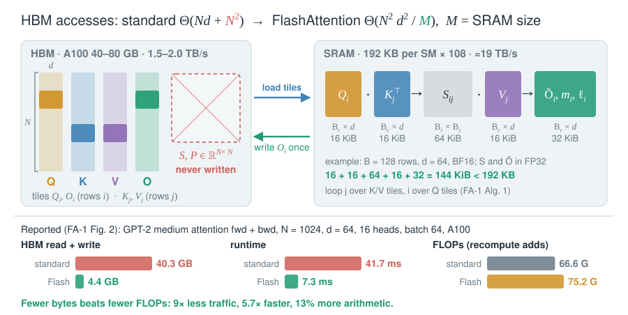
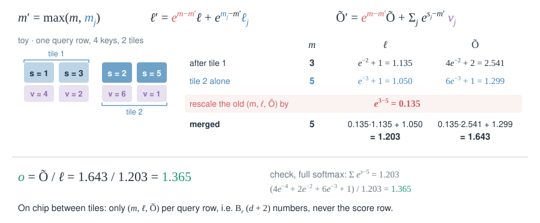

# 13 · Kernels

::: lede
Same exact attention, different schedule: kernels decide how many bytes cross HBM and how many SMs stay busy.
:::

## FlashAttention: tiles in SRAM, no $N\times N$ in HBM {#flash}

::: meta
**FlashAttention** 2022 · Dao, Fu, Ermon, Rudra, Ré · NeurIPS 2022 · [arXiv:2205.14135](https://arxiv.org/abs/2205.14135) · Used in: PyTorch SDPA, vLLM, Megatron-LM
:::

$$
m'=\max(m,\,m_j),\qquad \ell'=e^{m-m'}\ell+e^{m_j-m'}\ell_j,\qquad \tilde O'=e^{m-m'}\tilde O+e^{S_j-m'}V_j,\qquad O=\tilde O/\ell
$$

::: tips
- **Why it works:** softmax needs only a row max $m$ and row sum $\ell$, and both merge across tiles exactly.
- **Cost:** HBM accesses fall from $\Theta(Nd+N^2)$ to $\Theta(N^2d^2/M)$ (Thm. 2). FLOPs stay $O(N^2d)$; the backward pass recomputes $S$.
- **Numbers:** A100 SRAM ≈19 TB/s vs HBM 1.5–2.0 TB/s. Reported: 3× GPT-2 training, 15% faster BERT-large.
:::

## FA-2 → FA-3 → FA-4: re-tiled for each GPU {#fa-versions}

::: meta
**FlashAttention-2** 2023 · Dao · ICLR 2024 · [arXiv:2307.08691](https://arxiv.org/abs/2307.08691) — **FlashAttention-3** 2024 · Shah, …, Dao · NeurIPS 2024 · [arXiv:2407.08608](https://arxiv.org/abs/2407.08608) — **FlashAttention-4** 2026 · Zadouri, …, Dao · [arXiv:2603.05451](https://arxiv.org/abs/2603.05451)
:::

$$
O=\operatorname{diag}(\ell)^{-1}\tilde O\ \text{ once, after the last tile (FA-2)};\qquad m'=m\ \text{ unless }\ m_j-m>\tau,\ \ 2^{\tau}=256\ \text{(FA-4)}
$$

::: tips
- **Why it works:** every non-matmul FLOP (exp, rescale) costs 16–512 matmul FLOPs, so each version hides or removes them.
- **Numbers:** reported FA-4 on B200 BF16: 1.3× cuDNN 9.13, 2.7× Triton; CuTe-DSL compiles 20–30× faster than C++ templates.
- **Gotcha:** speed is tied to hardware. FA-2 reached only 35% on H100; FA-3 needs Hopper; FA-4 targets Blackwell.
:::

## Split-KV decoding (Flash-Decoding) {#flash-decoding}

::: meta
**Flash-Decoding** 2023 · Dao, Haziza, Massa, Sizov (Stanford CRFM, Meta) · [blog](https://crfm.stanford.edu/2023/10/12/flashdecoding.html) · Used in: FlashInfer (split-KV scheduler), FlashMLA (`num_splits`)
:::

$$
o=\sum_{s=1}^{S}e^{\,\text{LSE}_s-\text{LSE}}\,o_s,\qquad \text{LSE}_s=m_s+\log\ell_s,\qquad \text{LSE}=\log\sum_{s}e^{\text{LSE}_s}
$$

::: tips
- **Why it works:** decode has one query row, so blocks = batch × heads. Splitting $N$ adds blocks, and every SM pulls HBM bandwidth.
- **Cost:** bytes read are unchanged; it adds $S$ partial outputs and one small reduction.
- **Numbers:** reported, A100: attention up to 50× faster than FlashAttention; at batch 1 FlashAttention used <1% of the GPU.
:::

## FlashMLA and FlashInfer: decode kernels for real caches {#flashmla}

::: meta
**FlashMLA** 2025 · DeepSeek · [GitHub](https://github.com/deepseek-ai/FlashMLA) · Used in: DeepSeek-V3/V3.2/V4.1 serving — **FlashInfer** 2025 · Ye et al. · MLSys 2025 · [arXiv:2501.01005](https://arxiv.org/abs/2501.01005) · Used in: SGLang, vLLM, MLC-Engine
:::

$$
I=\frac{H_q\cdot 2\,\big((d_c+d_r)+d_c\big)}{(d_c+d_r)\,s}=\frac{128\cdot 2\cdot(576+512)}{576\cdot 2}\approx 242\ \text{FLOP/B}
$$

::: tips
- **Why it works:** after [weight absorption](04-latent-kv.md#absorb) all heads share one latent, so $G=128$ ([intensity = G](03-kv-heads.md#intensity)).
- **Gotcha:** FP8 KV (656 B) lifts intensity to ≈425 FLOP/B, past the ridge: absorbed MLA decode becomes compute-bound.
- **FlashInfer:** page tables and shared prefixes become BSR blocks; JIT variants. Reported 29–69% lower inter-token latency vs compiler backends.
:::

## Chunkwise kernels for linear and delta layers (FLA) {#fla}

::: meta
**FlashLinearAttention (GLA)** 2023 · Yang, Wang, Shen, Panda, Kim · ICML 2024 · [arXiv:2312.06635](https://arxiv.org/abs/2312.06635) — **DeltaNet chunkwise** 2024 · Yang et al. · NeurIPS 2024 · [arXiv:2406.06484](https://arxiv.org/abs/2406.06484) · Used in: [flash-linear-attention](https://github.com/fla-org/flash-linear-attention)
:::

$$
O_{[c]}=(Q_{[c]}K_{[c]}^{\top}\odot M)\,V_{[c]}+Q_{[c]}S_{[c-1]}^{\top},\qquad S_{[c]}=S_{[c-1]}+V_{[c]}^{\top}K_{[c]}
$$

::: tips
- **Math:** derivation and per-token costs are in [09](09-linear-state.md#chunkwise). This card shows where $S$ lives.
- **Gotcha:** decays need log-space factors inside a chunk; GLA adds a second sub-chunk level to keep half-precision matmuls.
- **Delta rule:** the chunk's product of Householder-like updates is rewritten in WY form, so it stays matmul-shaped ([10](10-delta-rule.md#deltanet)).
- **Train vs. infer:** prefill uses chunks; decode is the one-token recurrence on the cached $S$.
:::

## Low-bit attention: SageAttention 1 → 3 {#sage}

::: meta
**SageAttention** 2024 · Zhang et al., Tsinghua · ICLR 2025 · [arXiv:2410.02367](https://arxiv.org/abs/2410.02367) — **SageAttention2** · ICML 2025 · [arXiv:2411.10958](https://arxiv.org/abs/2411.10958) — **SageAttention3** · NeurIPS 2025 · [arXiv:2505.11594](https://arxiv.org/abs/2505.11594) · Used in: video diffusion inference (HunyuanVideo, CogVideoX, reported)
:::

$$
\operatorname{softmax}_j\big(q^{\top}(k_j-\mu_K)\big)=\operatorname{softmax}_j\big(q^{\top}k_j\big),\qquad QK^{\top}\approx\delta_Q\,\delta_K\,\big(Q_{\text{int8}}K_{\text{int8}}^{\top}\big)
$$

::: tips
- **Why it works:** keys share a large per-channel mean; $q^{\top}\mu_K$ is constant across $j$, so removing it is exact.
- **Compare:** this quantizes the *arithmetic*. [KV-cache quantization](14-serving.md#kv-quant) quantizes *storage* and dequantizes before the matmul.
- **Not solved:** 8-bit attention is lossless in fine-tuning but converges slower in pretraining (SageAttention3).
:::
