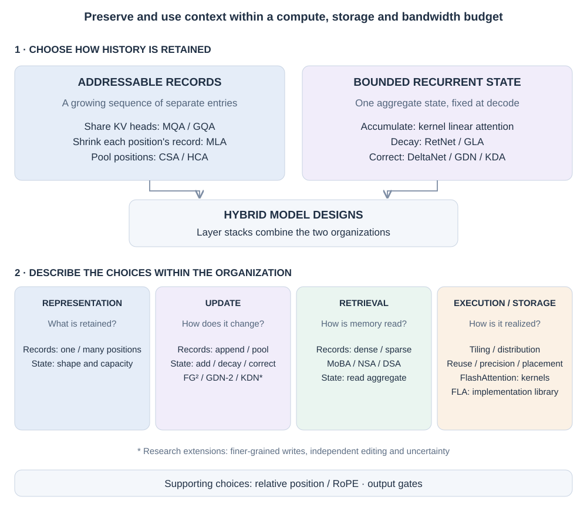

# 00. Attention as a context-memory system

The central question in this book is: **how can a model preserve and use the right parts of its past within a compute, storage and bandwidth budget?** The supplied PDF explains attention through that question. We use its framework to connect the mechanisms, then expand the reasoning behind each solution.

Consider a customer-service conversation. An early message names **order 7314** and schedules delivery for **Tuesday**. A later message changes delivery to **Friday**. Many unrelated messages follow. Finally, the user asks for the order number and current delivery day. This is an illustrative example, not a reported benchmark result.

The model needs several different abilities. It must find the order number, preserve the corrected delivery day, avoid mixing Tuesday and Friday, and do so without reading or retaining an unlimited amount of information. Increasing context length only makes more input available. It does not establish that the relevant fact will be retained, found, or updated correctly.

## Start with how history is organized

Ordinary cached attention keeps keys and values for historical positions. A new query compares with those keys and combines their values. In our example, the initial Tuesday statement and the Friday correction have separate stored representations. Chapter 01 explains this read; the first distinction in the map is whether later designs keep that collection of records or replace it with an aggregate state.

**Addressable records.** History remains a sequence of separately stored entries that a query can consult. MHA, MQA, GQA and MLA retain an entry for each historical position. Other designs pool groups of positions into fewer entries. Those pooled entries remain separately accessible, although the original positions inside each entry are no longer individually accessible through that compressed history. Record storage grows as the retained history grows.

**Bounded recurrent state.** Each new token updates an aggregate state, and a query reads that state. There is no separately stored entry for every old position. With model dimensions fixed, the carried decode state can stay the same size as the conversation grows. Kernel linear attention, GLA and DeltaNet provide different ways to update and read such a state; Chapters 04–05 explain them.

These are two **memory organizations**. “Recurrent attention” is a broad family description used here for attention mechanisms with bounded recurrent decode state. GQA and MLA name particular designs within the addressable-record route. “Sequence compression” names an operation within that route: pooling several positions into fewer records. CSA and HCA are named attention designs that use it. The organization, the operation and the named design answer different questions.

Both organizations have limits. An accessible entry does not guarantee that the model finds or interprets the right fact; an aggregate state must preserve useful associations despite finite capacity and interference. The phrase “exact retrieval” in the PDF is best understood as direct addressability, not perfect recovery. The [Linear Transformer formulation](https://proceedings.mlr.press/v119/katharopoulos20a.html) and [MLA design](https://arxiv.org/abs/2405.04434) make the difference concrete.

*Figure 00.1. Read the organization boxes first. The lower lanes expand different design questions within those organizations; their entries are examples, not interchangeable alternatives at one level.*

## Four questions make the design choices meaningful

**Representation: what is stored?** Within the addressable-record route, three changes should be distinguished:

- **Share KV across heads:** MQA and GQA reduce how many key/value views each position stores.
- **Compress each position's representation:** MLA stores a learned latent plus a positional key, keeping one record per position.
- **Pool positions into fewer records:** sequence compression reduces record count; CSA and HCA are examples developed in Chapter 07.

Recurrent attention takes the other organizational route: it carries an aggregate state instead of that growing record sequence. Its representation question is the shape and capacity of the state. A shorter list of records and a fixed-size state therefore have different growth and retrieval behavior.

**Update: how does stored information change?** A record cache usually appends a new entry or emits a pooled entry after a group of positions. A recurrent state instead changes existing aggregate memory. An additive update accumulates associations; forgetting gates decay old state; a delta update reads an association and writes its correction. GLA, DeltaNet and KDA are concrete designs whose update rules differ in these ways.

**Retrieval: which stored information does a query read?** For an addressable sequence, dense attention reads every allowed entry, while sparse attention restricts access using fixed patterns or query-dependent selection. “Sparse attention” describes that access choice; MoBA, NSA and DSA implement particular choices. Selection can operate over per-position or pooled records. A recurrent query reads the aggregate state, so it has no original-position list to select from.

**Execution and storage: how is the chosen computation realized?** FlashAttention schedules attention in tiles; Ring Attention distributes its blocks across devices. These are execution methods. Cross-layer cache reuse, quantization and host/SSD placement concern physical storage. They change the cost of a chosen memory design. Flash Linear Attention (FLA), discussed in Chapter 09, is a library implementing several recurrent mechanisms.

These questions let us explain a design by the organization it uses and the particular choices it makes. They also prevent a storage operation, an attention mechanism and an implementation library from becoming unexplained neighbors in a list.

## Combine the organizations at the model level

A hybrid architecture gives both organizations a place in the network. A recurrent layer can maintain useful evolving features cheaply; an occasional explicit-attention layer can consult detailed stored history. [Qwen3-Next](https://qwen.ai/blog?id=qwen3-next) and [Kimi Linear](https://arxiv.org/abs/2510.26692) are model designs that combine such layers. Chapter 08 specifies which mechanisms each uses. Their explicit-attention layers retain growing-history costs, so the combined architecture has its own scaling behavior.

Choosing which layers use which operation is **architectural composition**. Query-dependent routing, such as MoBA selecting context blocks, is an **access decision inside an operation**. A fixed hybrid layer schedule need not make a routing decision for each query.

## Progress is a set of parallel routes

| Route | Problem that drives it | Concrete designs or implementations |
| --- | --- | --- |
| Dynamic access | A single fixed summary limits input-dependent retrieval | Bahdanau/Luong attention; Transformer; multi-head attention |
| Smaller records | Per-position KV representations occupy too much space | MQA, GQA, MLA |
| Bounded evolving state | Retaining every historical position is expensive | Linear attention, RetNet, GLA; neighboring Mamba/SSD models |
| Editable state | Accumulation blurs conflicting facts; decay alone is too coarse | DeltaNet, Gated DeltaNet, KDA; GDN-2, FG²-GDN and KDN research extensions |
| Selective reads | Most queries need only a subset of long history | Longformer, BigBird, MoBA, MInference, NSA, DSA |
| Fewer records | Even compact per-token entries grow with sequence length | CSA and HCA, paired with recent uncompressed records |
| Better realization | Data movement and repeated physical storage limit efficiency | FlashAttention, Flash Linear Attention, Ring Attention, cross-layer reuse and KV quantization |
| Combined memory | One representation does not serve every retrieval/update need | Qwen3-Next and Kimi Linear; proposed future hierarchies |

The historical anchors matter, but a single ladder is misleading. MQA preceded GQA; they are also alternative sharing choices. Mamba is a neighboring state-space route rather than a required ancestor of DeltaNet. Sparse selection can work with several cache representations. A FlashAttention kernel can execute dense or supported sparse patterns without defining which information the model should retain.

## Read each chapter through its unresolved constraint

Start with [addressable attention](01-addressable-attention.md) and [KV sharing](02-kv-sharing.md). Then follow either [latent history](03-latent-kv.md) toward [selective reads](06-sparse-retrieval.md) and [sequence compression](07-sequence-compression.md), or [recurrent state](04-recurrent-memory.md) toward [memory editing](05-delta-memory.md). The routes meet in [hybrid memory](08-hybrid-memory.md).

[Execution and physical storage](09-execution-and-storage.md) explains why fewer operations do not always mean lower latency. [Frontier and design](10-frontier-and-design.md) asks what new update rules change and how to compare mechanisms fairly. Use the [mechanism matrix](../appendices/mechanism-matrix.md) to reconnect names with problems, and the [glossary](../appendices/glossary.md) for notation.

The aim is to understand a mechanism's useful change and remaining tradeoff. A larger maximum context, smaller cache, or better benchmark score can each be valuable, but they answer different questions. The book keeps demonstrated model designs, controlled research extensions, and proposed future architectures distinguishable.

*Reference basis: supplied PDF introduction and §§46–64, pp. 1–2 and 31–45. See the [reference note](../bibliography/reference-note.md) for complete coverage and technical refinements.*
