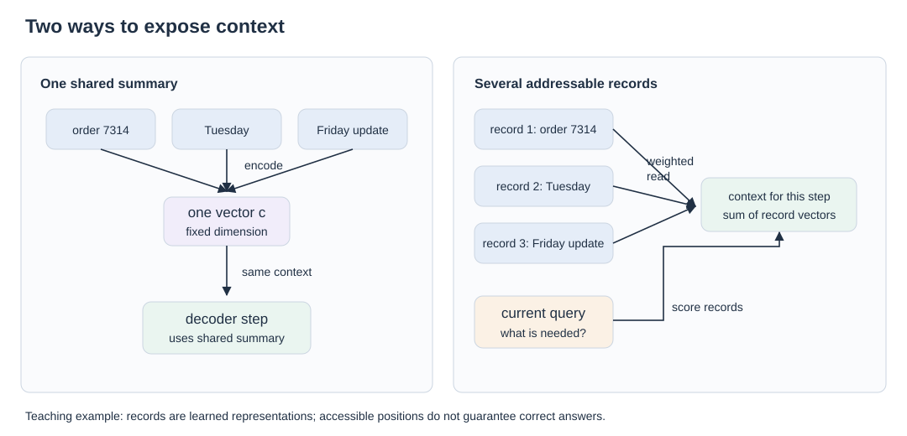
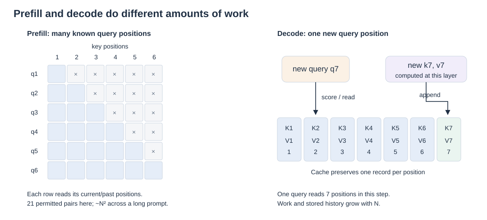

# 01 · From one summary to addressable context

Consider an illustrative conversation: **order 7314 will arrive Tuesday**. Later, someone corrects the delivery day to **Friday**. Many unrelated messages follow. The user finally asks for the order ID and current delivery day. A useful model must locate the original identifier, connect the correction to that order, and interpret which statement is current. This example will recur throughout the book; it is a teaching scenario, not a benchmark result.

The question behind attention is therefore concrete: **what form of memory lets the next computation find useful context?** Start with this question before comparing algorithms or their costs.

## Why one context vector became a bottleneck

An early encoder–decoder could read an entire source sentence into one fixed-size vector and give that vector to a decoder. Every output word then depended on the same compressed context. As sentences grew, the encoder had to squeeze more potentially relevant distinctions through that interface.

[Bahdanau, Cho, and Bengio's 2014 work](https://arxiv.org/abs/1409.0473) instead kept a sequence of encoder annotations. At each output step, a learned alignment network scored those annotations and formed a weighted context. The decoder could consult different source positions for different words, while the encoder and alignment mechanism learned together. [Luong and colleagues, in 2015](https://arxiv.org/abs/1508.04025), explored dot/general scoring and global or local access.

This changes the memory interface. A computation receives access to multiple contextual records rather than one shared summary. The records are learned representations, not copies of raw words: an encoder annotation may already contain information from surrounding positions.

## Query, match, read

Modern notation separates three roles. A **query** describes the information the current computation seeks. A **key** supplies features against which that query can match. A **value** supplies the content contributed after matching. None is a literal database field; all are vectors learned through the model's training objective.

Use column vectors: \(q_t,k_j\in\mathbb{R}^{d_k}\), \(v_j\in\mathbb{R}^{d_v}\). For one attention head, a score and read are

\[
e_{tj}=\frac{q_t^\top k_j}{\sqrt{d_k}}+m_{tj},\qquad
\alpha_{tj}=\frac{\exp(e_{tj})}{\sum_r\exp(e_{tr})},\qquad
o_t=\sum_j\alpha_{tj}v_j.
\]

The mask \(m_{tj}\) is zero for permitted connections and negative infinity for forbidden ones. Softmax makes permitted weights sum to one. The scale prevents dot-product magnitudes from growing unchecked as head dimensions increase.

For the order example, a query might favor representations of the order identifier; another computation might combine the delivery statement and its correction. These are useful intuitions, not prescribed instructions given to individual heads. **Keeping a position accessible does not guarantee retrieving its fact correctly.** A model can assign poor weights, blend conflicting values, or misinterpret the readout.

## Transformer and multiple views of memory

The [2017 Transformer](https://arxiv.org/abs/1706.03762) made attention the central sequence-mixing operation. It did not invent attention or self-attention. Its attention sublayers operate alongside feed-forward layers, residual paths, and normalization.

Multi-head attention forms several learned query/key/value projections. Their readouts are concatenated and projected back into the model representation. Several heads can therefore use different matching spaces and weight patterns over the same context. Heads are not assigned permanent linguistic jobs such as “syntax” or “order numbers.”

Two independent distinctions prevent confusion later:

| Question | Choices | Meaning |
| --- | --- | --- |
| Where do representations originate? | Self-attention / cross-attention | Self-attention obtains Q/K/V from the same stream. Cross-attention obtains Q from one stream and K/V from another, such as decoder queries over encoder outputs. |
| Which connections are permitted? | Bidirectional / causal visibility | Bidirectional access can use both directions within its input. Causal access permits the current position and preceding positions. |

A causal mask concerns visibility; it does not specify how many KV heads exist or whether representations are compressed. In autoregressive training, inputs and prediction targets are shifted appropriately: permitting a position to read itself does not reveal the next target token.

## Positions help interpret the records

Content matching alone lacks an explicit account of sequence order. “Tuesday, then corrected to Friday” differs from the reversed sequence. Positional information gives the learned matching process a way to represent such distinctions, although it does not itself implement a correction rule.

[Relative position representations, introduced in this Transformer form in 2018](https://arxiv.org/abs/1803.02155), attach learned information about offsets between positions. [RoPE, proposed in 2021](https://arxiv.org/abs/2104.09864), rotates query/key coordinate pairs according to position; their dot product consequently incorporates relative displacement. These are supporting design choices, compatible with several memory architectures. Their placement becomes particularly important when we derive MLA's projection absorption.

## Prefill and decode expose different costs

When processing a known prompt, **prefill** computes representations for many positions together. A dense causal head has \(N(N+1)/2\) permitted query–key interactions across \(N\) positions. Its pairwise work scales quadratically with N at fixed dimensions. The logical interaction grid need not be stored as one full GPU-memory matrix; [chapter 09](09-execution-and-storage.md) explains execution strategies.

During ordinary cached **decode**, one new position arrives. The model produces its query, key, and value at every layer, appends the new K/V, and reads the existing records. It need not recompute previous positions' K/V. The attention read now scales with the history length per new token, while the cache itself also grows with that history. The [MQA paper's incremental-attention analysis](https://arxiv.org/html/1911.02150v1#S2.SS4) makes the bandwidth implication explicit.

Take a deliberately small, illustrative configuration: one sequence, two layers, four KV heads, 8 key and 8 value elements per head, and 2 bytes per element. At 1,000 positions its cache contains

`1 × 2 × 1,000 × 4 × (8 + 8) × 2 = 256,000 bytes`.

Adding one position adds 256 bytes across those layers. The model also reads historical records while computing that step. Storage capacity and read bandwidth are related costs, but distinct: one concerns how much fits, the other how quickly existing data can be supplied.

The [next chapter](02-kv-sharing.md) keeps positions individually addressable and changes how many representations each position stores. This is the first major route away from an expensive full multi-head cache. The [opening memory map](00-the-memory-map.md) places it alongside the other routes.

**Reference PDF:** this chapter reorganizes the retrieval, historical foundations, multi-head, and cache explanations on **pages 1–5**. See the [reference and adaptation note](../bibliography/reference-note.md).
