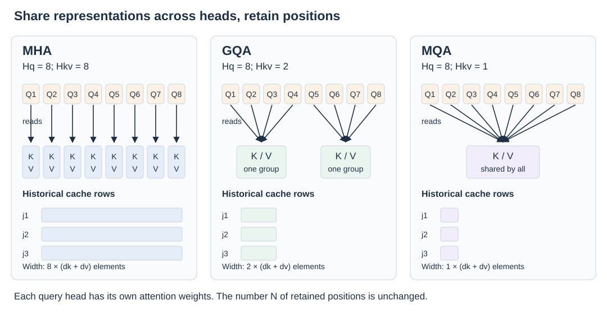

# 02 · Keep the positions, share their keys and values

An addressable context is useful only if the serving system can afford to retain and read it. For order 7314, keeping both the Tuesday statement and Friday correction preserves the opportunity to interpret the update. Yet a long conversation supplies many more positions, and every attention layer may retain representations of all of them.

The first optimization route asks a narrower question: **can each position occupy fewer cache elements while the model still uses multiple query heads?** MQA and GQA answer by sharing key/value representations across query heads. They change the width of each stored record, while keeping the records associated with individual positions.

## Two pressures: capacity and bandwidth

Let N be retained context positions, L attention layers, B concurrent sequences of equal length, and s bytes per stored element. Let \(H_q\) be query heads and \(H_{kv}\) KV heads, each with key dimension \(d_k\) and value dimension \(d_v\). A conventional dense cache requires

\[
M_{\mathrm{KV}}=BNL H_{kv}(d_k+d_v)s.
\]

This counts key and value data, not model weights, allocator overhead, activations, or temporary buffers. For different sequence lengths or layer configurations, sum the corresponding terms rather than assuming uniform N and L.

**Capacity** limits the context lengths and simultaneous requests that fit in memory. **Bandwidth** affects how quickly cached data reaches the arithmetic units during decoding. A small number of new queries can require substantial historical data. Reducing stored KV width can improve both pressures, without implying an equal reduction in total model latency.

In standard multi-head attention, \(H_{kv}=H_q\): each query head has its own learned key/value projections. If there are 32 query heads, each historical position stores 32 key vectors and 32 value vectors. Distinct representations provide flexibility, but also enlarge the cache.

## MQA retains multiple queries and one KV representation

[Multi-query attention, proposed by Shazeer in 2019](https://arxiv.org/abs/1911.02150), uses one key head and one value head shared across the query heads. Its purpose was to reduce the memory traffic of incremental decoding.

With column vectors, write \(q_{t,i}\) for query head i, while \(k_j,v_j\) have no head index. Each head still computes its own score distribution:

\[
\alpha_{t,i,j}=\operatorname{softmax}_j
\left(\frac{q_{t,i}^{\top}k_j}{\sqrt{d_k}}+m_{tj}\right),
\qquad
o_{t,i}=\sum_j\alpha_{t,i,j}v_j.
\]

Different queries can assign different weights to the same stored values. Sharing KV therefore does not collapse every head to the same answer. For the running example, separate queries may emphasize the identifier, the delivery correction, or the relationship between statements. Their shared representations must support those different reads.

Under otherwise identical dimensions, MQA stores \(1/H_q\) as many KV elements as MHA. That is a cache-element ratio, not a measured end-to-end speedup. Query projections, scoring work, output computation, model weights, and other layers remain part of inference.

The tradeoff is representation sharing: the model has fewer independently learned key/value views. The original experiments found favorable decoding efficiency with relatively small quality changes in their tested settings. This does not establish that sharing is harmless for every architecture, scale, or workload.

## GQA makes the amount of sharing adjustable

[Grouped-query attention, introduced in 2023](https://arxiv.org/abs/2305.13245), uses an intermediate number of KV heads. Query heads are divided into groups; each group reads its associated key/value head. If 32 query heads use 8 KV heads, four queries share each KV pair.

Use a mapping \(g(i)\) from query head i to its KV group. Then a head reads \(k_{j,g(i)},v_{j,g(i)}\) instead of entirely separate or universally shared vectors. There is one softmax distribution per query head, not one distribution imposed on the entire group.

The endpoints make the relationship clear:

| Configuration | \(H_q\) | \(H_{kv}\) | Sharing |
| --- | --- | --- | --- |
| MHA | 32 | 32 | A separate KV pair per query head |
| GQA | 32 | 8 | Four query heads per KV pair |
| MQA | 32 | 1 | All query heads share one KV pair |

GQA is a tunable architectural compromise. Its paper also studies converting existing MHA checkpoints by pooling KV projections and performing further training. The reported results approach MHA quality with inference speed near MQA in the evaluated models; they are evidence for that recipe, not a universal quality ordering.

Replacing a trained model's projections without adaptation changes its computations. A serving implementation cannot generally turn arbitrary MHA weights into equivalent GQA simply by discarding cache heads. Sharing must be designed or learned into the model.

## A worked storage calculation

Keep every factor fixed except the number of KV heads. Our illustrative configuration uses B = 1, N = 8,192, L = 32, \(H_q=32\), \(d_k=d_v=128\), and s = 2 bytes. For MHA:

`1 × 8,192 × 32 × 32 × (128 + 128) × 2 = 4,294,967,296 bytes = 4 GiB`.

For GQA with eight KV heads, the same calculation gives **1 GiB**. For MQA with one KV head, it gives **128 MiB**. Here GiB and MiB use powers of 1,024; these are exact results for the stated hypothetical layout.

At four simultaneous sequences of that length, the totals become 16 GiB, 4 GiB, and 512 MiB respectively. For one additional position, each sequence adds 512 KiB in MHA, 128 KiB in this GQA configuration, or 16 KiB in MQA across all 32 layers.

These numbers expose why record width matters. They do not predict kernel bandwidth directly: physical replication, sharding, caching, and reuse affect real traffic. A good implementation reuses shared KV data instead of physically expanding it into duplicate heads. The ratio becomes useful only when the storage and execution actually honor the sharing.

## What sharing leaves open

MHA, MQA, and GQA all retain a record at every included position. For dense attention they still permit every query head to compare against the visible history. Doubling N doubles cache storage and the number of historical positions read per new token; dense prefill still has quadratic pairwise interactions.

The memory question has narrowed from “how many independent views do we store?” to “can a compact learned record support richer views when needed?” [MLA answers](03-latent-kv.md) with a latent representation and a change in the projection algebra. For cache placement and precision, see [chapter 09](09-execution-and-storage.md).

**Reference PDF:** this chapter develops the capacity/bandwidth and MQA/GQA explanations on **pages 4–6**, using the cost-factor lens introduced on **page 15**. See the [reference and adaptation note](../bibliography/reference-note.md).
