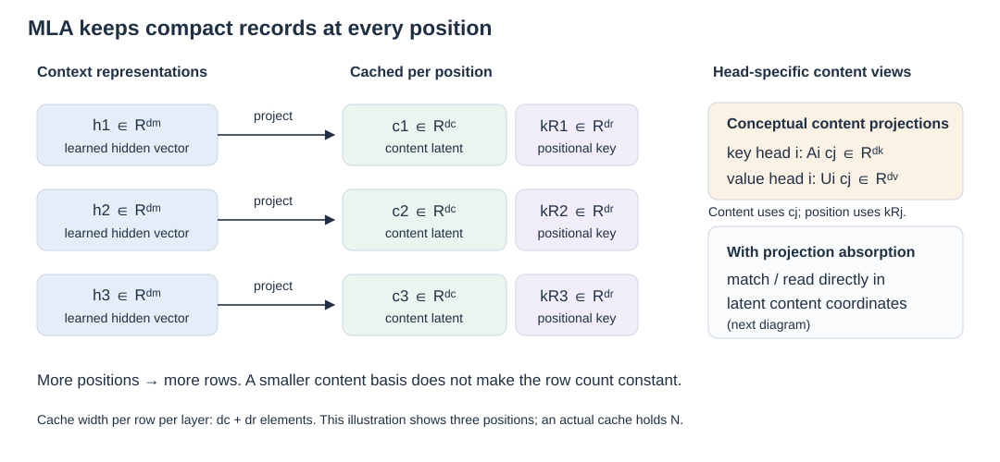
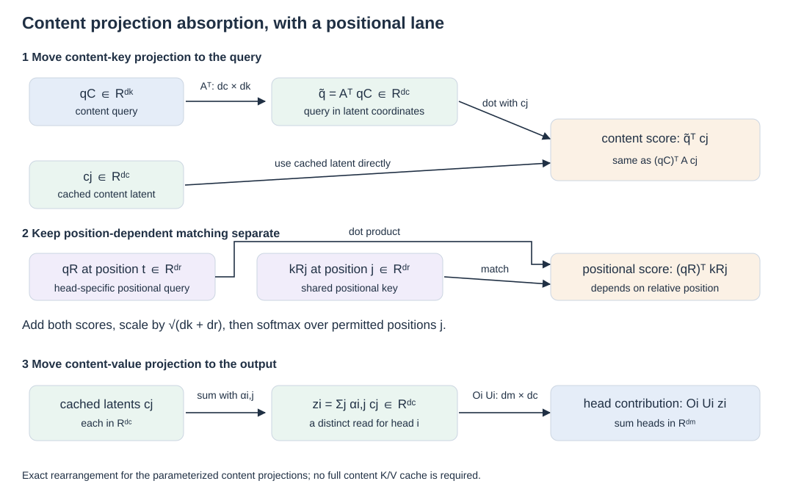

# 03 · MLA: compact records, attention in latent coordinates

Head sharing reduces the number of KV vectors at each position. **Multi-head Latent Attention (MLA)** asks whether a small learned vector can jointly support the content keys and values of multiple heads. It preserves a record for every historical position, so order 7314's initial statement and later correction remain separately accessible through their representations.

[DeepSeek-V2 introduced MLA in 2024](https://arxiv.org/abs/2405.04434). Here compression means **making each position's record smaller**. [Sequence compression](07-sequence-compression.md) instead pools positions into fewer records; [recurrent memory](04-recurrent-memory.md) replaces the growing record sequence with an aggregate state. These are three different uses of compression. This chapter derives MLA's content-side computation and then restores the separate positional component needed by the actual design.

## A jointly learned latent record

Let the hidden representation of position j be a column \(h_j\in\mathbb{R}^{d_m}\). Form

\[
c_j=W_Dh_j\in\mathbb{R}^{d_c},\qquad
W_D\in\mathbb{R}^{d_c\times d_m}.
\]

For head i, content keys and values are parameterized as

\[
k^C_{j,i}=A_i c_j,\quad A_i\in\mathbb{R}^{d_k\times d_c};
\qquad
v_{j,i}=U_i c_j,\quad U_i\in\mathbb{R}^{d_v\times d_c}.
\]

The superscript C distinguishes content coordinates from the positional lane below. Rather than caching every expanded head vector, keep \(c_j\). The model learns the low-rank parameterization during training; this is not a guarantee that any previously trained MHA cache can be compressed without changing its behavior.

Small records and head-specific reads can coexist. All heads use the same \(c_j\), but their query, key, value, and output transformations differ. A shared storage basis does not force identical attention distributions.

## Absorb the content-key projection into the query

First ignore positions to expose the algebra. With content query \(q^C_{t,i}\in\mathbb{R}^{d_k}\), the score contribution is

\[
(q^C_{t,i})^\top k^C_{j,i}
=(q^C_{t,i})^\top A_i c_j
=(A_i^\top q^C_{t,i})^\top c_j.
\]

Define \(\widetilde q_{t,i}=A_i^\top q^C_{t,i}\in\mathbb{R}^{d_c}\). Now the score uses a transformed query and the cached latent directly. If \(q^C_{t,i}=P_i h_t\), then \(A_i^\top P_i\) is a fixed combined projection with dimensions \(d_c\times d_m\).

This is ordinary associativity: it changes where a multiplication occurs. It does not add another approximation to the already chosen parameterization. We no longer need to materialize a separate content-key vector for every cached position before matching.

As an original arithmetic check, take a two-element latent and one-dimensional content key: \(A=[2\;3]\), \(c=[4\;5]^\top\), and \(q=7\). Expanding first gives \(k=23\) and score 161. Absorbing gives \(\widetilde q=[14\;21]^\top\), whose dot product with c is also 161. Both paths describe the same scalar.

## Absorb the value projection into the output

Let \(\alpha_{t,i,j}\) be the head's normalized attention weights. Define a weighted latent read

\[
z_{t,i}=\sum_j\alpha_{t,i,j}c_j\in\mathbb{R}^{d_c}.
\]

Linearity gives

\[
o_{t,i}=\sum_j\alpha_{t,i,j}U_i c_j=U_i z_{t,i}.
\]

Split the final output projection into head blocks \(O_i\in\mathbb{R}^{d_m\times d_v}\). Its output is

\[
u_t=\sum_i O_i o_{t,i}
=\sum_i (O_iU_i)z_{t,i}.
\]

Thus \(T_i=O_iU_i\in\mathbb{R}^{d_m\times d_c}\) combines the value and output projections. **Each head still has its own weighted latent read**, because its weights can differ. One cannot replace all those reads with a single shared z merely because the cache is shared.

For another illustrative check, let \(U=[1\;2]\), an output scalar projection O = 3, and z = \([4\;5]^\top\). Projecting in two steps gives \(3\times14=42\); the absorbed projection \([3\;6]\) also gives 42. These small checks show equivalence of evaluation paths, not empirical model quality.

The [DeepSeek-V2 architecture section](https://arxiv.org/html/2405.04434v5#S2.SS1.SSS2) explicitly uses this absorption. Practical kernels can implement equivalent computations differently; the algebra specifies a possibility, not a compulsory physical layout.

## Why the positional lane must remain separate

Apply a position-dependent rotation to an expanded key and the content score becomes \((q^C_t)^\top R_jA_i c_j\). The transformation to absorb now depends on historical position j. With a rotated query as well, a relative rotation sits between the projections. A single fixed query-side matrix generally cannot eliminate that dependency.

MLA uses **decoupled RoPE**: head-specific positional queries and a shared positional key \(k^R_j\in\mathbb{R}^{d_r}\), cached alongside the latent. The complete score is

\[
e_{t,i,j}=\frac{
\widetilde q_{t,i}^{\top}c_j+
(q^R_{t,i})^{\top}k^R_j
}{\sqrt{d_k+d_r}}+m_{tj}.
\]

Softmax uses that combined score before the latent read. Content absorption therefore leaves position-sensitive matching intact. The cache width per position per layer is **\(d_c+d_r\)**, not just \(d_c\). The [paper's decoupled-position section](https://arxiv.org/html/2405.04434v5#S2.SS1.SSS3) is essential to understanding why the compact formulation works.

## Smaller records still accumulate

Consider an illustrative configuration with \(d_c=512\), \(d_r=64\), s = 2 bytes, B = 1, and L = 32. Each position needs 576 elements per layer. At N = 8,192, the cache is

`1 × 8,192 × 32 × 576 × 2 = 301,989,888 bytes = 288 MiB`.

At N = 1,048,576 it becomes **36 GiB**. This is simple growth under fixed assumptions, not a claim about a particular model's supported context length. More concurrent sequences multiply the total again. The DeepSeek-V2 report's **93.3%** cache reduction is a comparison against its stated DeepSeek 67B baseline, not an architecture-wide constant.

MLA retains individually addressed latent records, not guaranteed verbatim facts. Dense queries still compare against growing history. The next routes change how many historical records are [read](06-sparse-retrieval.md) or [retained](07-sequence-compression.md), or replace those records with a [fixed recurrent state](04-recurrent-memory.md). Understanding this distinction prevents a cache-compression result from being mistaken for a solution to every long-context cost.

**Reference PDF:** this chapter develops the explicit-versus-recurrent comparison and MLA explanation on **pages 12–15**, correcting the simplified content-only cache picture with the original paper's positional lane. See the [reference and adaptation note](../bibliography/reference-note.md).
