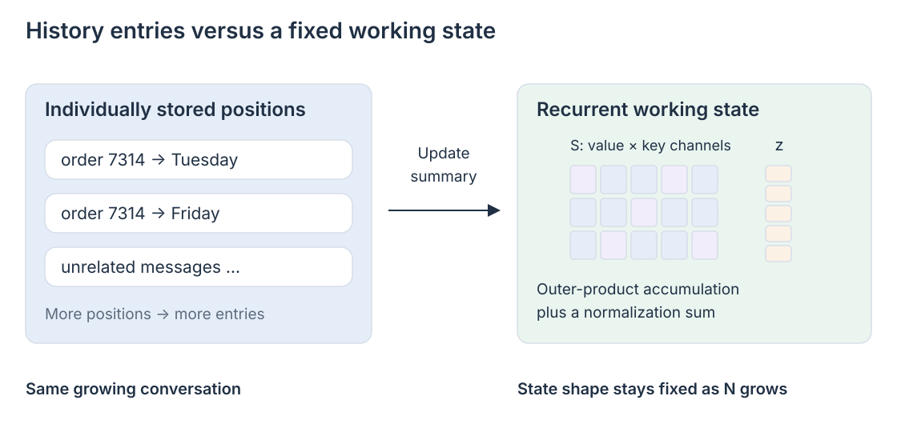

# 04 · Compressing history into recurrent memory

The support conversation keeps growing. Order **7314** was initially due on Tuesday, then corrected to Friday. Hundreds of unrelated messages follow. Storing an individual key and value for every message lets a later query inspect that history, but it also makes the cache grow with the conversation. A different design keeps updating a small working memory instead. Its storage can stay fixed while the number of messages increases.

That is the attraction of recurrent attention: turn a growing collection of entries into a state that can be updated and queried. Here the term describes a family of memory mechanisms, not one algorithm alongside GQA or MLA. We start with kernel linear attention, then examine RetNet and GLA as specific designs with different state updates. The hard question moves from how to store every token to what a bounded state can preserve. Our order example is illustrative; it is not a measured failure of any named model.

This chapter develops the recurrent-state and matrix-memory discussion on PDF pages 6–10, with the capacity comparison on pages 12–13. The [reference note](../bibliography/reference-note.md) records how that article is used.

## From a sum over tokens to one matrix

For one causal attention head, replace the exponential softmax kernel with a feature-map kernel. Write \(\tilde q_t=\phi(q_t)\) and \(\tilde k_t=\phi(k_t)\), both column vectors in \(\mathbb R^{d_k}\). A nonnegative feature map makes the following normalized weighting straightforward:

\[
o_t=
\frac{\sum_{i\le t}v_i\,\tilde k_i^\top\tilde q_t}
{\sum_{i\le t}\tilde k_i^\top\tilde q_t}.
\]

The numerator can be regrouped without changing this kernel-attention expression. Define a matrix and a normalization vector:

\[
S_t=S_{t-1}+v_t\tilde k_t^\top,
\qquad z_t=z_{t-1}+\tilde k_t,
\]

\[
o_t=\frac{S_t\tilde q_t}{z_t^\top\tilde q_t+\varepsilon},
\qquad S_t\in\mathbb R^{d_v\times d_k}.
\]

The small \(\varepsilon\) is an implementation safeguard for a tiny denominator. Ignoring that safeguard, reassociation is exact for the selected feature-map kernel; choosing that kernel changes the attention rule. It is not generally the original softmax rule computed in another order. This recurrent formulation was established by the 2020 Linear Transformer work. [Linear Transformers](https://proceedings.mlr.press/v119/katharopoulos20a.html)

Each new token contributes an outer product. The key determines where the contribution lands in the matrix; the value determines what it contains. A query reads \(S_t\tilde q_t\), mixing the contributions whose keys align with that query. The denominator normalizes their combined weight.

With dimensions fixed, processing \(N\) positions requires work proportional to \(N\), and decoding carries \(d_vd_k+d_k\) state elements per head. Neither number depends on the current prefix length. Increasing head widths, batch size \(B\), or the number of recurrent layers still increases memory. “Fixed state” describes its dependence on \(N\), not a negligible absolute size.

## What aggregation into a fixed state gives up

The state has no separate slot labeled “the second mention of order 7314.” Several contributions occupy the same coordinates. Learned key directions help separate them, but nonorthogonal directions interfere. A query can therefore read a mixture rather than an individually addressable record.

Repeated facts present another problem. A simple additive update reinforces both Tuesday and Friday. Normalization can turn that reinforcement into an average; it does not express the instruction that Friday supersedes Tuesday. The model can learn useful representations around this operator, but the operator itself accumulates evidence rather than editing a record.

Memory capacity is consequently part of the architecture. More channels can separate more associations, at increased state and compute cost. Smaller states demand more selective compression. At finite precision, a bounded state cannot preserve arbitrary amounts of independent history losslessly. The practical question is which information a task needs, and whether the representation preserves it after intervening messages.

## Retention adds a time scale

An additive state also preserves irrelevant contributions indefinitely. RetNet introduces decay and different retention time scales across heads. Suppressing its positional rotations and surrounding normalization/output gating, the core recurrence in our column-vector convention is:

\[
S_t=\gamma S_{t-1}+v_tk_t^\top,
\qquad o_t=S_tq_t.
\]

Here \(\gamma\) is a fixed per-head retention factor. A contribution written at position \(i\) is multiplied by \(\gamma^{t-i}\) at position \(t\). Heads with different factors can specialize in different horizons. RetNet also supplies parallel, recurrent, and chunkwise forms of the same retention computation. [RetNet, §2](https://arxiv.org/html/2307.08621v4)

Those forms answer different execution needs. The recurrent form updates one state during generation. The parallel form computes many training outputs together from pairwise interactions weighted by decay. The chunkwise form computes interactions within a chunk in parallel and passes a summary between chunks. They are execution representations of the mechanism, not three different meanings of memory.

A fixed time scale cannot know that an old order identifier remains essential while a recent greeting can be discarded. It reduces the lifetime of both according to distance. This motivates a gate that depends on the input.

## Adaptive forgetting

Gated Linear Attention makes forgetting data dependent. One useful simplified variant decays key channels separately:

\[
D_t=\operatorname{diag}(\alpha_{t,1},\ldots,\alpha_{t,d_k}),
\qquad S_t=S_{t-1}D_t+v_tk_t^\top.
\]

Right multiplication scales the columns of our \(d_v\times d_k\) state. The learned gate can retain one direction while fading another. GLA's broader formulation allows gates on key and value dimensions and includes a separate output gate; the equation isolates the memory operation. Its chunkwise algorithms make adaptive forgetting compatible with practical parallel training. [GLA, §§2–3](https://arxiv.org/html/2312.06635v3)

The gate is computed from the current layer input. Depending on that input, the model can distinguish a conversation transition from a detail to preserve. This helps manage limited capacity, but it does not make the additive write a targeted replacement. [The next chapter](05-delta-memory.md) introduces the delta correction that addresses that second problem.

## The adjacent state-space branch

Mamba also uses a selective recurrent state, but comes from state-space modeling. Input-dependent state-space parameters decide what enters and persists in that state. Mamba-2's structured state-space duality relates an important structured SSM family to attention-style matrix computations and develops efficient algorithms from that connection. [Mamba](https://arxiv.org/abs/2312.00752), [Mamba-2, §§2–6](https://arxiv.org/html/2405.21060v1)

The relationship explains why attention and SSM discussions increasingly meet. It does not make every SSM ordinary softmax attention, or every recurrent memory identical. Compare their transition structure, state size, retrieval behavior, and execution method. For order 7314, all these designs must still decide what survives the unrelated messages and how the correction to Friday is represented.
