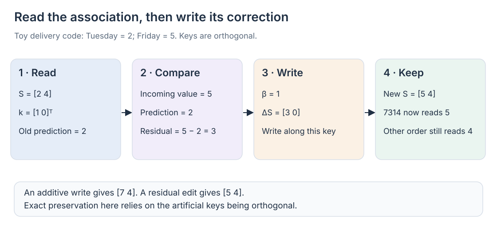

# 05 · Editing memory with the delta rule

An order correction is different from an additional observation. “Order **7314** is due Friday” should replace the earlier Tuesday association, while preserving information about other orders. A memory that only adds new key–value products has no explicit operation for that replacement. Decay can clear old information, but broad decay also weakens unrelated associations.

The delta rule introduces a targeted edit. Read what the state currently predicts for a key, compare it with the incoming value, and write the difference. This chapter develops the article's DeltaNet → Gated DeltaNet → KDA sequence, from PDF pages 10–13 and 25–26. See the [reference note](../bibliography/reference-note.md) for source provenance.

## Deriving the correction

Use column keys and values, with \(S\in\mathbb R^{d_v\times d_k}\). For the current pair \((k_t,v_t)\), treat the state as a small associative map and define the reconstruction loss

\[
\ell_t(S)=\tfrac12\lVert Sk_t-v_t\rVert^2.
\]

The gradient with respect to the matrix is

\[
\nabla_S\ell_t=(Sk_t-v_t)k_t^\top.
\]

A gradient step of size \(\beta_t\) therefore gives

\[
S_t=S_{t-1}+\beta_t
\underbrace{(v_t-S_{t-1}k_t)}_{\text{prediction residual}}
k_t^\top.
\]

Equivalently,

\[
S_t=S_{t-1}(I-\beta_tk_tk_t^\top)
+\beta_tv_tk_t^\top,
\qquad o_t=S_tq_t.
\]

The read \(S_{t-1}k_t\) is subtracted before the new value is reinforced. This fast-weight interpretation connects linear attention to an online learning rule; the transient state changes during sequence processing while the model's trained projection weights remain fixed. [Fast Weight Programmers, §§2–3](https://arxiv.org/html/2102.11174v1)

The target is a value produced by the model's learned projections, not a verified database record. The local loss asks the state to reproduce that representation when addressed by its key. Training must teach the surrounding model which inputs count as useful updates. A quotation repeating an old delivery estimate should not necessarily have the same effect as an authorized correction, even if both mention the order ID.

For a unit key and \(\beta_t=1\), querying that same key immediately after the edit returns \(v_t\). This follows by multiplying the update by \(k_t\): the residual is added once because \(k_t^\top k_t=1\). For a smaller step, the old prediction moves partway toward the target.

Another query \(q\) changes by \(\beta_t(v_t-S_{t-1}k_t)k_t^\top q\). An orthogonal query is unaffected; a similar query changes. Targeted editing thus reduces a particular conflict without eliminating interference among similar keys. Key normalization and bounded update parameters matter for stability.

## A small worked example

Use an artificial one-number encoding of delivery days: Tuesday is 2 and Friday is 5. Real models use learned vectors; these numbers only expose the arithmetic. Let \(d_v=1\), \(d_k=2\), and

\[
S_{t-1}=[2\quad4],
\qquad k_t=\begin{bmatrix}1\\0\end{bmatrix},
\qquad v_t=5.
\]

The first direction represents order 7314; an orthogonal second direction represents another order whose stored value is 4. An additive write produces \([7\quad4]\). A separately normalized additive memory, after two equally weighted observations for the first key, would average Tuesday and Friday to 3.5. Neither operation expresses an unconditional replacement.

The delta residual is \(5-2=3\). With \(\beta_t=1\), the update adds \([3\quad0]\), giving \([5\quad4]\). With \(\beta_t=0.5\), it gives \([3.5\quad4]\): a deliberate partial correction rather than an accidental accumulation.

This exact preservation of the other order relies on the toy keys being orthogonal. If both orders use overlapping directions, the edit also changes their shared components. The example isolates the mechanism; it does not promise error-free record storage.

## Forget first, then correct the faded prediction

DeltaNet can edit associations, but outdated information may still occupy the state. Gated DeltaNet combines adaptive forgetting with delta correction. Define the faded state first:

\[
\bar S_t=\alpha_tS_{t-1},
\qquad
S_t=\bar S_t+\beta_t(v_t-\bar S_tk_t)k_t^\top.
\]

Expanding gives

\[
S_t=\alpha_tS_{t-1}(I-\beta_tk_tk_t^\top)
+\beta_tv_tk_t^\top.
\]

This is the gated delta rule in our matrix convention. The decay gate clears stale information; the residual edits the association being written. [Gated Delta Networks, §§2–3](https://arxiv.org/html/2412.06464v3)

The sequence of operations matters. In the example, \(\alpha_t=0.8\) gives \(\bar S_t=[1.6\quad3.2]\). With \(\beta_t=0.5\), the residual is \(5-1.6=3.4\), so the result is \([3.3\quad3.2]\). Computing the residual from the unfaded value 2 would instead give 3.1 in the first coordinate. That is a different recurrence.

The model learns the gates from token representations; the example fixes them so their roles are visible. A scalar decay applies to the whole head. Clearing capacity can therefore reduce an unrelated association, as the second value's decline from 4 to 3.2 shows.

## KDA gives key channels different lifetimes

Kimi Delta Attention replaces the per-head scalar decay with a diagonal matrix:

\[
D_t=\operatorname{diag}(\alpha_{t,1},\ldots,\alpha_{t,d_k}),
\quad \bar S_t=S_{t-1}D_t,
\]

\[
S_t=\bar S_t+\beta_t(v_t-\bar S_tk_t)k_t^\top
=S_{t-1}D_t(I-\beta_tk_tk_t^\top)
+\beta_tv_tk_t^\top.
\]

Columns correspond to key channels in this notation. KDA can fade them at different rates, while keeping a scalar delta strength \(\beta_t\) for each head and position. This is finer control over existing capacity, rather than an unbounded expansion of that capacity. [Kimi Linear, §§2–3](https://arxiv.org/html/2510.26692v1)

Choosing \(D_t=\operatorname{diag}(0.8,1)\) in our toy example gives \([1.6\quad4]\) before correction. A full correction then produces \([5\quad4]\): the edited direction changes while the other direction retains its value. Learned channels need not correspond cleanly to individual orders, so this remains an illustration of column-selective decay.

Diagonal fading and key-directed correction generally do **not** commute. The product \(D_t(I-\beta_tk_tk_t^\top)\) is written in this order because the update reads the faded state. Swapping its factors changes the mechanism for a key spread across differently decayed channels.

## Editing does not require serial training

A step-by-step recurrence explains generation clearly, but training one token at a time would underuse GPUs. DeltaNet's structured transitions can be composed into chunkwise parallel computations. The 2024 parallel DeltaNet work develops this approach, and Gated DeltaNet and KDA extend it for their gates. The implementations are specialized because a memory correction is more structured than an additive sum. [Parallelizing DeltaNet, §§2–3](https://arxiv.org/html/2406.06484v1)

To see why composition is possible, write a step as \(S_t=S_{t-1}A_t+U_t\). Two steps combine into \(S_t=S_{t-2}A_{t-1}A_t+U_{t-1}A_t+U_t\). A chunk can therefore describe how it transforms its incoming state and what it contributes locally. Efficient algorithms exploit the diagonal and rank-one structure rather than multiplying arbitrary dense transition matrices at every position. The gates and keys are computed from the layer inputs, so these transition factors are available before carrying the state through the chunk. Causality is preserved: a training output still depends only on its permitted prefix, even when many outputs are evaluated together.

These mechanisms address three progressively distinct questions: what association is wrong, what stale information should fade, and which key channels need different lifetimes. They still summarize history into bounded state. A final question about order 7314 may require detail that the summary no longer retains, which motivates the explicit-attention layers in [hybrid architectures](08-hybrid-memory.md).
