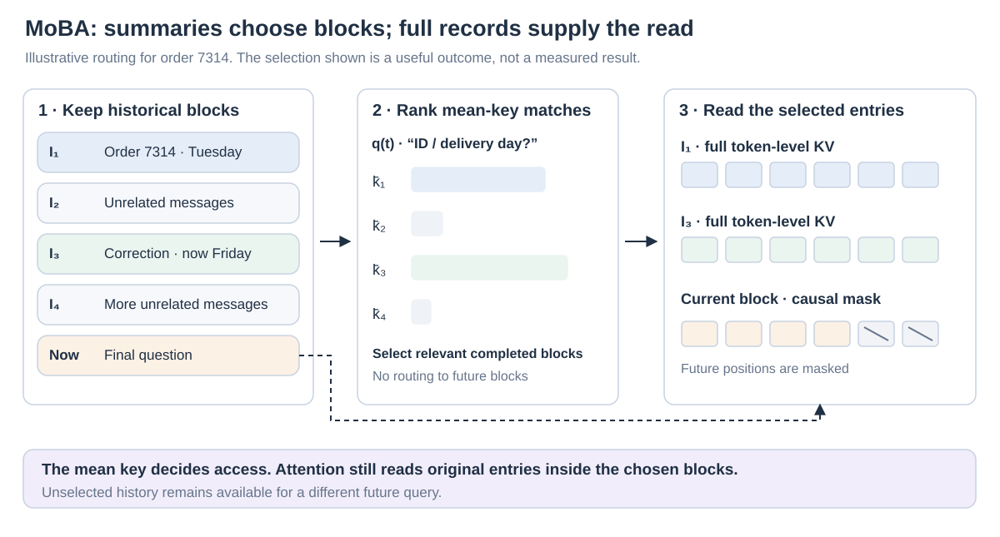
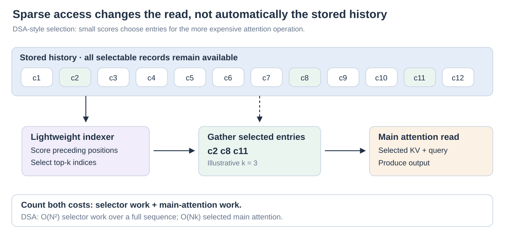

# 06 · Sparse retrieval: choosing which history to read

**The problem:** a small cache entry can still be expensive when every query reads every entry. **The idea:** spend the main attention computation on a useful subset of history. **The remaining question:** how reliably and cheaply can that subset be selected?

“Sparse attention” names this broad access strategy. Longformer, MoBA, NSA and DSA are particular designs; MInference applies a sparse approximation during inference. This access question is separate from GQA's KV sharing or MLA's per-position representation, which explains why one model can combine those choices.

Our customer-service conversation contains order **7314**, an initial Tuesday delivery date, a correction to **Friday**, and many unrelated messages. The final question asks for the order ID and current delivery day. A useful read must connect the identity with the correction. Their positions need not be adjacent. These examples illustrate design choices; they are not measured failures of particular models.

## Stored history and accessed history are different

Suppose a layer stores records for all **N** context positions. Dense cached decoding evaluates a new query against that history; across all queries in prefill, the number of causal pairs grows quadratically. Sparse attention reduces the pairs that receive the expensive attention computation. It can retain the same stored history so a different future query can select a different subset.

Let `A_t` be the allowed positions for query `q_t`. A sparse read has the familiar form, now restricted to that set:

`o_t = Σ_{j∈A_t} softmax_{A_t}(q_tᵀk_j / √d_k) v_j`

The softmax normalizes over selected positions. Dropping other positions therefore generally changes the output. This is a change in access, alongside choices about how keys and values are represented. Compressing each record and choosing fewer records can work together.

## Local and global patterns: decide the connections in advance

[Longformer](https://arxiv.org/abs/2004.05150) combines local windows with designated global positions. A global position reads the whole sequence, and other positions can read it. Classification can use a global classification token; document QA can give question tokens global access. This lets information cross distances that a local window alone cannot cover. With a bounded window and bounded number of global positions, the connection count scales linearly in sequence length. The original design is largely for bidirectional document processing; a causal decoder must enforce its own visibility rules.

[BigBird](https://arxiv.org/abs/2007.14062) adds random connections to local and global ones. These create additional paths for distant information to meet across layers. Its theoretical expressivity results concern the specified graph and assumptions; they do not guarantee that every practical model will recover an arbitrary buried fact.

In our example, a recent window might contain the final question while the Friday correction is distant. Global connections can carry useful information, but predetermined links cannot ensure direct access to precisely that correction for every query. This motivates content-dependent selection.

## MoBA: route queries to blocks, then read the original tokens

[Mixture of Block Attention, or MoBA](https://arxiv.org/abs/2502.13189), partitions history into contiguous blocks. For a completed block `I_b`, it forms a representative mean key:

`k̄_b = mean_{j∈I_b}(k_j)`

The routing score is `q_tᵀk̄_b`. Top-scoring past blocks are selected, and ordinary attention reads the **individual keys and values inside them**. The mean is a routing summary, not the value returned by attention. The original router introduces no separate learned routing parameters; its decisions depend on learned query/key representations.

The current block is always included with a causal mask. Routing by the mean of that whole block could expose future tokens during parallel training, so current-block access is handled separately. Future blocks are excluded. The resulting read combines selected historical blocks with causally visible local content. The paper studies sparse training and mixtures with full-attention layers; compatibility does not make every unadapted checkpoint equally reliable.

For order 7314, successful routing would include the order-identification block and the Friday-correction block. A challenge is dilution: one important correction may share a block with much unrelated material. Smaller blocks make selection more precise, while increasing the number of block scores and changing kernel efficiency. That tradeoff belongs in the evaluation, rather than being resolved by a sparsity percentage alone.

## MInference: approximate a trained model's reads at inference

[MInference](https://arxiv.org/abs/2407.02490) addresses expensive **prefill** without retraining the language model. An offline search assigns each head an attention-pattern family. At runtime, it builds the corresponding sparse indices and uses specialized kernels. The families are initial-token plus local-window **A-shape**, dynamic **Vertical-Slash** connections, and dynamic **Block-Sparse** regions. A-shape indices are static; the other families adapt their locations to the input.

This is a training-free approximation of attention in an existing model. It differs from training a model to operate with sparse reads, and from an exact dense kernel that simply schedules the same mathematics efficiently. Prefill acceleration also does not by itself remove the historical KV records required for later decoding. Quality must be checked on the deployed model and task.

## NSA: train the summary, the detailed read, and the local read together

[Native Sparse Attention, or NSA](https://arxiv.org/abs/2502.11089), builds three branches. **Compression** learns summaries of overlapping token blocks. **Selection** uses the compression attention scores to rank blocks, then reads original token-level KV entries in chosen blocks. Scores are aggregated across query heads sharing a KV group so the group uses a consistent selection. **Sliding-window attention** handles recent context. Input-dependent gates combine the three branch outputs.

Thus the model receives broad summarized context, detailed access to selected regions, and recent local information. NSA is designed for native training and hardware-aligned block access, rather than selecting isolated tokens arbitrarily. The original architecture gives the branches independent KV representations. Its summary branch does not eliminate the original historical entries needed by the selected-detail branch. Fewer detailed reads and smaller total stored memory remain separate questions.

## DSA: a lightweight indexer chooses entries for the main attention

[DeepSeek Sparse Attention, or DSA](https://arxiv.org/abs/2512.02556), uses a small **lightning indexer** to score preceding positions. Weighted indexer-head matches pass through ReLU; the top-`k` scores determine which historical entries the main attention reads. DeepSeek-V3.2 instantiates this under MLA, sharing selected latent KV entries across query heads.

The indexer is first aligned with dense attention distributions while the main model is frozen. Sparse continued training then adapts the main model and indexer with their respective objectives. This is trained selection, not a guarantee that a cheap score always identifies the best evidence.

The report distinguishes **O(Nk)** main attention from the indexer's remaining **O(N²)** work over a complete sequence. For one decode query, the indexer still scores a growing history. Fewer heads and lower-cost arithmetic make this useful in practice; they do not turn the complete mechanism into an asymptotically linear selector. Historical entries and indexer keys also remain stored.

## Compare the decision, not just the name

| Mechanism | Access decision | Training relationship | Cache implication |
| --- | --- | --- | --- |
| Longformer / BigBird | Local, global, optionally random links | Train with the chosen graph | Connection sparsity alone does not imply cache eviction |
| MoBA | Mean-key scores select blocks; current block included | Sparse training or model adaptation | Original entries inside selectable blocks remain available |
| MInference | Head-pattern search and runtime sparse indices | Applied without model retraining | Primarily changes prefill reads |
| NSA | Summaries guide detailed block reads; local branch | Native sparse training | Summaries coexist with detailed history |
| DSA | Learned lightweight scores select entries | Dense indexer warm-up, then sparse continued training | Retains historical and indexing representations |

For our conversation, ask whether identity and corrected date both survive selection, whether an obsolete date distracts the reader, and whether the method still works when the correction moves. Measure selection overhead alongside main-attention latency, and report prefill separately from decode. The next chapter changes another variable: the number of historical records themselves.

*Reference connection: develops the PDF's sparse-retrieval route and its later access-versus-storage distinction; see the [source and page-span note](../bibliography/reference-note.md).*
