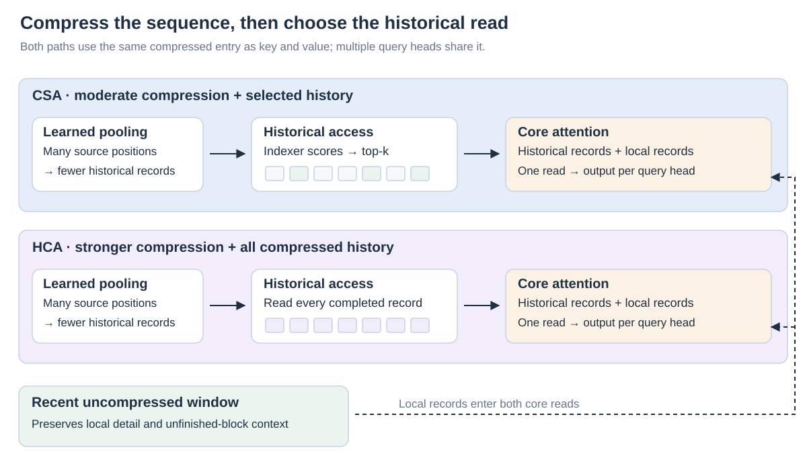
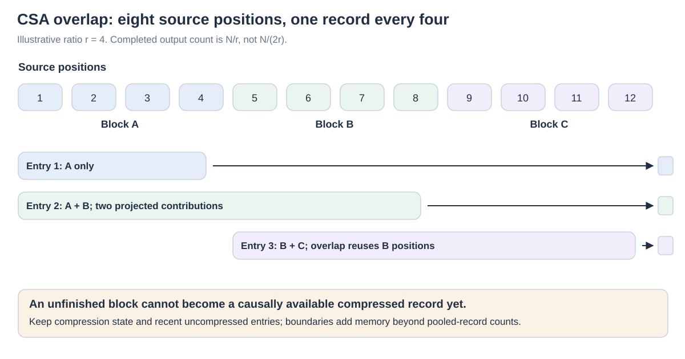

# 07 · Sequence compression: fewer historical records

**The problem:** MLA makes each historical record smaller, but the record count still grows with context. **The idea:** represent several positions with one learned entry, then choose how to read that shorter history. **The tradeoff:** fewer records preserve less directly accessible detail.

**Sequence compression is an operation, not the name of one attention algorithm.** CSA and HCA are attention designs that use this operation and specify how queries read its outputs. The outputs still form a growing sequence of addressable records. This differs from recurrent memory, which continually updates a bounded aggregate state.

In the running conversation, order **7314** first has a Tuesday delivery date, later corrected to **Friday**. A compressed representation should preserve the link between the order and its current date despite many intervening messages. Merely preserving the topic “delivery” would be insufficient. This example concerns what a representation must retain, not a reported result for any named model.

## From the size of a record to the number of records

With [MLA](https://arxiv.org/abs/2405.04434), a historical position has a compact learned KV latent, with a separate positional component. Lowering that latent dimension reduces the space per record; there is still a sequence of records corresponding to historical positions. Sparse access can read only some of them without removing the rest.

Sequence compression instead constructs records covering groups of positions. If a simplified compressor emits one `d_c`-dimensional vector every `r` tokens, a complete sequence has approximately `N/r` records. Ignoring boundaries and auxiliary states, storage for that component would be:

`compressed storage ≈ B × L × (N/r) × d_c × s`

Here **B** is batch size, **L** the number of layers storing this component, and **s** bytes per element. This is a bookkeeping illustration, not a full model footprint. Local records, selector keys, unfinished blocks, metadata and heterogeneous layer configurations add other terms.

## CSA and HCA make different reads from compressed history

[DeepSeek-V4](https://arxiv.org/abs/2606.19348) interleaves **Compressed Sparse Attention (CSA)** and **Heavily Compressed Attention (HCA)**. CSA pools historical positions into entries, then an indexer selects relevant compressed entries. HCA uses a much larger pooling ratio and attends to **all causally available compressed entries**. Both also include recent uncompressed entries.

The V4 core read uses **shared-KV MQA**: multiple query heads share entries, and the same compressed vector serves as both key and value. It retains low-rank query construction, but is not simply the unchanged V2/V3 MLA cache with a smaller token count. “MLA → CSA/HCA” is a useful problem progression, not an assertion that the mechanism is identical.

The distinction separates two budgets. Compression controls **how many records exist**; sparse selection controls **how many records a query reads**. HCA changes the first budget while retaining a dense read over its compressed sequence. CSA changes both.

## The actual CSA compressor overlaps adjacent blocks

The [official reference implementation](https://huggingface.co/deepseek-ai/DeepSeek-V4-Pro/blob/main/inference/model.py) implements learned gated pooling. Candidate vectors and scores are projected from hidden states; position-dependent biases contribute to the scores. A softmax across source positions produces **per-channel** pooling weights. The compressed vector is their weighted sum, rather than an arithmetic mean or a retained original token.

For CSA's ratio `r`, each emitted entry incorporates the current `r`-position block and a separately projected contribution from the previous block. An interior entry therefore sees **2r source positions**, while entries are emitted every **r positions**. Adjacent source windows overlap. The first entry has no preceding block; missing contributions are masked. This overlap does **not** halve the output-record count again: complete blocks still yield about `N/r` entries, rather than `N/(2r)`.

For example, with `r=4`, three complete blocks of twelve positions produce three compressed entries. The second combines positions 1–4 and 5–8; the third combines 5–8 and 9–12. Their different projections and weights can preserve different information from the shared block.

The overlap helps relationships straddling a block boundary contribute to a common record. It does not make pooling lossless. If “order 7314” and “Friday” are far apart, one record will not cover both; subsequent attention layers must combine the appropriate evidence.

## HCA and the local branch preserve complementary information

HCA uses non-overlapping source blocks and stronger pooling. A query reads completed compressed blocks throughout history, subject to causality. The retained global representation remains a growing sequence; it has not become a single fixed recurrent state.

Both designs also read a recent uncompressed window. This provides detail around the current query and exposes information in a block before that block is fully compressed and eligible for the historical read. The local and compressed records participate in the core attention read together; this should not be drawn as NSA's separately gated three-branch output sum. A recent Friday correction can therefore be read directly. Once it leaves the window, its accessible information depends on compressed representations.

| Design | Historical representation | Historical access | Recent detail |
| --- | --- | --- | --- |
| MLA | Latent record per position | Dense unless combined with sparsity | Individual historical positions remain represented |
| CSA | Overlapping learned pooling, one entry per `r` positions | Selected compressed entries | Uncompressed local window |
| HCA | Stronger non-overlapping pooling | All eligible compressed entries | Uncompressed local window |

## Counts are useful; boundaries and auxiliary states still matter

The [official V4-Pro configuration](https://huggingface.co/deepseek-ai/DeepSeek-V4-Pro/blob/main/inference/config.json) uses CSA ratio **4**, HCA ratio **128**, and a recent window of **128** positions. Its core layers start with two HCA layers and subsequently alternate CSA and HCA. A per-layer ratio list therefore matters more than one model-wide compression factor.

As an **illustrative count**, 1,024 positions give 256 ratio-four records or eight ratio-128 records after completing all blocks. Those counts exclude local entries and indexing data; each query can only read records whose source blocks have finished. CSA's selector has its own compressed indexing representation. The reference implementation also maintains state for incomplete and overlapping blocks. Counting pooled vectors alone consequently understates the memory needed during serving.

At fixed ratios, HCA's full-sequence pairwise work still grows roughly as `N²/r`, and the CSA selector still scores a growing compressed history. A much smaller constant can be valuable without changing the asymptotic class. Cross-layer sharing and numeric storage precision address additional factors in [Chapter 09](09-execution-and-storage.md).

## What should an evaluation establish?

The [official model card](https://huggingface.co/deepseek-ai/DeepSeek-V4-Pro) reports million-position context support and long-context benchmark results, including MRCR and CorpusQA. Such evidence concerns the trained model as a whole. Changes in model size, data, training and inference settings prevent attributing all quality or efficiency differences to one compressor.

A focused evaluation would move the Friday correction across pooling boundaries, delay the final query until it leaves the local window, and introduce similar orders with conflicting dates. Check both exact identifiers and revised facts, not just topic-level summaries. For efficiency, count main compressed entries, local state and selector storage separately, then measure full prefill and decode under the same workload.

Compression removes individually addressable positions from older history; it can still retain useful associations in learned records. Its value depends on which information survives, how it can be retrieved, and the resource savings obtained at that quality level.

*Reference connection: develops the PDF's CSA/HCA route and its distinction between entry-size and sequence-length compression; see the [source and page-span note](../bibliography/reference-note.md).*
