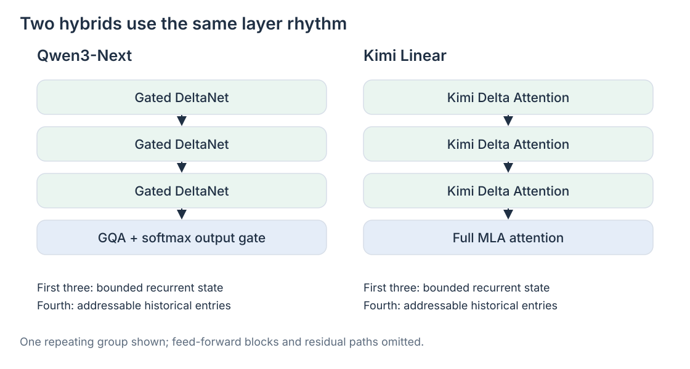
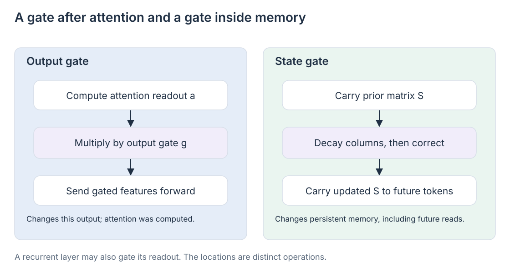

# 08 · Combining recurrent memory with explicit retrieval

The support assistant should keep the correction to Friday active without repeatedly scanning every message. It may also need to inspect the exact wording of the customer who changed order **7314**. Those are different demands: maintaining a useful summary and retrieving a specific piece of history.

A hybrid architecture assigns both kinds of operation a place in the model. Recurrent layers carry bounded working state; explicit-attention layers retain individually addressable history entries. This is useful even when the recurrent cell has sophisticated forgetting and delta corrections, because those operations improve how a summary is managed without making it lossless.

This chapter expands PDF pages 22–28, especially the gate distinction, Qwen3-Next/Kimi Linear comparison, and memory-hierarchy diagram. The [reference note](../bibliography/reference-note.md) distinguishes the supplied article from the primary evidence.

## Layer stacks divide the work

Qwen3-Next uses a layerwise mixture of Gated DeltaNet and gated softmax attention. Its 48-layer design repeats three recurrent layers followed by one explicit-attention layer, yielding 36 recurrent and 12 explicit-attention layers. Kimi Linear repeats three KDA layers followed by one full MLA layer. These are documented model designs, rather than a rule that every hybrid must use a 3:1 ratio. [Qwen3-Next official model card](https://huggingface.co/Qwen/Qwen3-Next-80B-A3B-Instruct), [Kimi Linear, §4](https://arxiv.org/html/2510.26692v1)

The recurrent layers update context representations inexpensively with respect to prefix length. At the explicit layers, each query can compare its current representation with stored history. In Kimi Linear, MLA compresses each position's representation while preserving a separate entry for that position. In Qwen3-Next, the global softmax layers use grouped-query attention with an additional output gate.

Compare the hybrids at the same levels. **Recurrent mechanism:** GDN in Qwen3-Next, KDA in Kimi Linear. **Explicit-record representation:** GQA in Qwen3-Next, MLA in Kimi Linear. **Output modulation:** Qwen3-Next's explicit attention adds a gate after its softmax read. A representation choice and an output gate are separate properties, so “gated softmax versus MLA” alone is an incomplete description. Saying only that their “high-precision memory differs” also leaves out KDA's channel-wise decay.

In our conversation, a recurrent layer might maintain that the current delivery day is Friday. An explicit layer can inspect positions around the correction when the query asks who authorized it. This is an explanatory division of labor. Actual roles are learned across many layers; there is no literal database field assigned to one layer.

## A gate's location determines its meaning

The word “gated” describes several operations. A softmax output gate modulates a computed feature; a state-decay gate changes what later queries can read from recurrent memory. Compare them using the same current layer input \(x_t\).

For one explicit-attention head, let

\[
a_t=\sum_{i\le t}p_{t,i}v_i,
\qquad
p_{t,i}=\frac{\exp(q_t^\top k_i/\sqrt{d_k})}
{\sum_{j\le t}\exp(q_t^\top k_j/\sqrt{d_k})}.
\]

A head-specific sigmoid gate produces compatible output features:

\[
g_t=\sigma(W_gx_t),
\qquad \hat a_t=g_t\odot a_t.
\]

The gate is applied after scaled dot-product attention and before the head outputs are combined and projected. It controls which computed channels flow into the next representation. The 2025 gated-attention study investigates this placement and attributes benefits to added nonlinearity and query-dependent sparse output modulation. [Gated Attention, §§3–4](https://arxiv.org/abs/2505.06708)

An output near zero does not imply the attention products were skipped. The gate can suppress features after the expensive operation has happened. Its sparsity differs from an indexer selecting fewer historical keys before attention.

For recurrent attention, the decay appears inside the state update:

\[
\bar S_t=S_{t-1}D_t,
\qquad S_t=\bar S_t+\beta_t(v_t-\bar S_tk_t)k_t^\top.
\]

Here \(D_t\) changes persistent memory; \(\beta_t\) controls the correction. Their effects continue into later tokens. A recurrent layer may also multiply its readout \(S_tq_t\) by an output gate. Kimi Linear includes such gating, so “GDN gates memory, softmax gates output” is a useful comparison of locations, not an exclusive classification of entire architectures. [Kimi Linear, §4](https://arxiv.org/html/2510.26692v1)

## Count both kinds of storage

A pure recurrent head carries approximately \(s\,d_vd_k\) bytes for its matrix state, plus any auxiliary states, with \(s\) the bytes per stored element. The explicit layers still carry a cache that grows with \(N\). For batch size \(B\), a useful bookkeeping expression is

\[
M\approx B\left[
\sum_{\ell\in\mathcal R}\sum_h s_\ell d_{v,\ell,h}d_{k,\ell,h}
+N\sum_{\ell\in\mathcal E}c_\ell\right],
\]

where \(\mathcal R\) and \(\mathcal E\) are the recurrent and explicit-layer sets, and \(c_\ell\) is that explicit layer's stored bytes per position. Projections, normalization buffers, and implementation overhead are outside this simplified expression.

Replacing some global layers reduces the coefficient of the growing cache; it does not remove that term. Likewise, dense explicit layers retain quadratic pairwise prefill work even if fewer layers perform it. Calling the whole hybrid “constant-memory attention” would hide this remaining cost.

## Memory hierarchy is a design lens

The article's memory-hierarchy picture combines several decisions. First choose **where information is retained**: bounded recurrent state, addressable records, or both. Within the record component, choose **what a record represents**: one position's latent, as in MLA, or pooled positions, as in sequence compression. Then choose **which records a query reads**: all allowed records or a selected subset. Sparse access is a read policy over retained records, rather than a third kind of storage beside state and records.

These decisions can be combined into a hierarchy, but the mechanisms do not require one universal sequence of stages. MLA and sparse access can coexist without recurrence; a recurrent layer can use output gating without sparse retrieval. Cross-layer reuse and quantization further change physical storage. Describe the choices separately before treating the result as a hierarchy.

A 2026 example joins two axes within the explicit side: Qwen3.8-Next retains the GDN/global layer mixture and replaces the global component with Qwen Sparse Attention during continued pretraining. The report describes a lightweight indexer over compressed micro-block representations. It shows the hybrid pattern extending toward selective retrieval, not a claim that all attention is being replaced by recurrent state. [Qwen3.8-Next report, attention design](https://arxiv.org/abs/2608.30320)

When choosing a hybrid, test whether order 7314 survives distractors, whether Friday overrides Tuesday, and whether a source quotation remains retrievable. Then measure the cache and runtime of the complete architecture. The recurrent cell and explicit retrieval component must be judged together.
