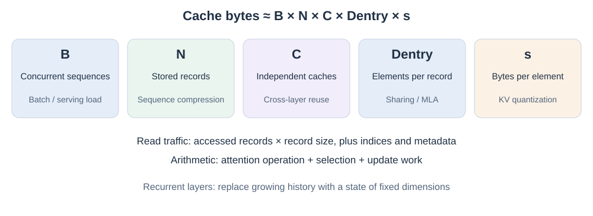
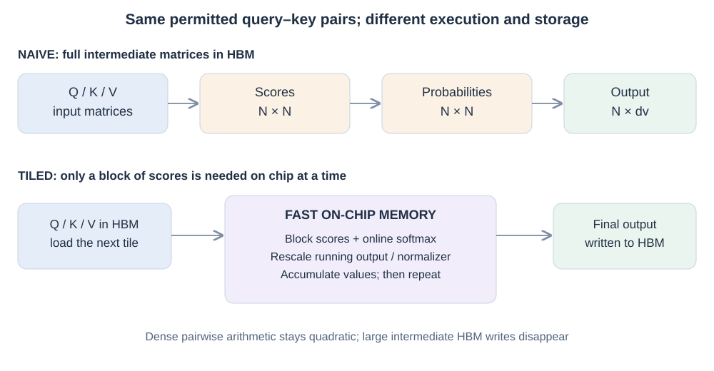

# 09. Executing and storing the memory system

Suppose two models retain the same historical entries and read the same positions. One writes enormous intermediate attention matrices to GPU memory; the other computes the read in tiles. They implement the same memory access rule, yet their runtime can differ substantially. Conversely, a model can reduce arithmetic while repeatedly moving a large state through slow memory.

The problem in this chapter is **how to realize a useful attention mechanism with less data movement and less physical storage**. The PDF separates this systems question from the mathematical definition of attention. That separation is essential for interpreting efficiency claims.

## Begin with bytes, reads and work as separate quantities

For a uniform conventional KV cache, a teaching storage model is

$$M_{KV}=B\,N\,C\,H_{kv}(d_k+d_v)\,s.$$

Here $B$ is batch or concurrent sequences, $N$ is stored context positions, $C$ is the number of independently stored cache sets, $H_{kv}$ is the KV head count, and $s$ is bytes per element. Usually $C=L$, the number of relevant layers, but sharing can reduce $C$ while the network still has $L$ layers. Real caches add scales, indices, alignment and other metadata. Different layers may use different representations, requiring a sum rather than one uniform product.

Several kinds of change appear in this product. **Representation choices** change the number of elements per record: head sharing reduces $H_{kv}$, while MLA uses a different latent-record layout. **Sequence compression** changes how many records represent the history. **Physical storage choices** change independently retained cache sets $C$ through cross-layer reuse, or bytes per element $s$ through quantization. These act on different factors and can sometimes be combined. None of those factors alone states how many bytes a query reads or how much arithmetic it performs.

*Figure 09.1. Cache capacity is a product of storage factors. Read traffic additionally depends on access count and layout; arithmetic additionally depends on the chosen operation. Bounded recurrent state replaces the growing-history term, while its state dimensions and traffic remain relevant.*

For example, an illustrative group of four layers can share one cache while retaining four different query transformations. Stored sets fall from four to one. If every layer still performs a read, read traffic need not fall fourfold. This is why a cache-size reduction should not be reported as the same reduction in latency.

## FlashAttention: avoid the large intermediate matrices

A straightforward dense implementation forms $QK^T$, stores scores, applies softmax, stores probabilities, then multiplies by $V$. Those intermediate matrices have $N\times N$ entries. Writing and rereading them can dominate memory traffic.

[FlashAttention](https://arxiv.org/abs/2205.14135) loads tiles into on-chip memory and maintains online softmax statistics while accumulating the output. Scores need not be materialized as a complete matrix in GPU HBM. During the backward pass, selected intermediates are recomputed instead of all being saved. The operation remains dense attention, subject to ordinary numerical differences; pairwise arithmetic remains quadratic.

*Figure 09.2. The change is in execution and intermediate storage. Every allowed query–key pair can still participate in the result. The diagram abstracts thread scheduling and the backward pass.*

The subsequent versions address different hardware bottlenecks:

| Version | Main execution problem | Change |
| --- | --- | --- |
| [FA-2, 2023](https://arxiv.org/abs/2307.08691) | Poor work partitioning and shared-memory communication | More parallel work, fewer non-matrix operations and better warp/block partitioning |
| [FA-3, 2024](https://arxiv.org/abs/2407.08608) | Hopper features are underused | Asynchronous overlap and pipelines; a separate low-precision path |
| [FA-4, 2026](https://arxiv.org/abs/2603.05451) | Blackwell matrix throughput grows faster than several other resources | Redesigned pipelines, reduced non-matrix overhead and different use of tensor/shared memory |

Version numbers therefore do not imply an architecture-independent speed ranking. Hardware, precision, head dimensions, masks and workload determine which implementation helps. Low-precision variants also require numerical evaluation.

## Recurrent kernels and distributed context

[Flash Linear Attention](https://github.com/fla-org/flash-linear-attention) is an implementation library for multiple recurrent and attention architectures. It supplies efficient ways to execute their update rules. It is not a single additional mathematical memory mechanism. Chunkwise training can parallelize many updates, but a practical implementation must still handle scans, state matrices and data movement.

[Ring Attention](https://arxiv.org/abs/2310.01889) addresses another constraint: a long sequence may exceed one device's memory. Devices retain local query blocks while circulating key/value blocks around a ring, overlapping communication with blockwise computation when conditions permit. Each query can eventually incorporate all relevant blocks. The sequence is distributed; attention is not automatically sparse or recurrent because of that distribution.

Both examples reinforce a useful rule: examine the operation and the schedule separately. Hardware-efficient recurrent execution and distributed exact attention solve different problems.

## Reduce repeated cache storage across layers

Head sharing removes repeated representations among query heads. [Cross-Layer Attention](https://arxiv.org/abs/2405.12981) extends sharing across adjacent layers: distinct query computations read shared keys and values. Sharing limits representation freedom and requires an appropriate architecture or adaptation. It is not generally achieved by deleting arbitrary caches from a pretrained model.

The important storage quantity is how many distinct caches are produced and retained. In the running order example, four layers may transform the order query differently while reusing the same stored historical representation. This does not mean four layers have become one, or that the retrieved features are identical.

## Reduce bytes per stored element

KV quantization represents cache elements with fewer bits, with scales or other metadata. It changes numerical precision as well as storage. Errors in keys can change attention scores; errors in values can change the content of the read. The useful granularity can differ: [KIVI](https://arxiv.org/abs/2402.02750) studies per-channel key quantization and per-token value quantization.

An illustrative move from two bytes to half a byte per element suggests a fourfold raw-element reduction. Actual memory savings also depend on scale metadata, alignment, residual high-precision storage and the specific format. Throughput additionally depends on unpacking, dequantization and kernel support. A smaller cache is useful even when latency does not scale by the same factor.

[DeepSeek-V4.1-Flash](https://arxiv.org/abs/2609.19969) combines cross-layer KV reuse in CSA2 with FP4 caching. Its report states **890 bytes per token for its global HBM cache**, approximately one quarter of the corresponding DeepSeek-V4-Flash footprint. That figure describes a particular model and cache component, not all memory used by the model. Its persistent host/SSD cache is treated separately, including approximate bounded replay of local-window states. This example extends the PDF's factor lens without collapsing several storage quantities into one number.

## Distinguish cache management from learned memory

[PagedAttention](https://arxiv.org/abs/2309.06180) organizes KV storage in physical blocks to reduce fragmentation and support sharing. Prefix caches can keep reusable computations in GPU memory, host memory or SSD. Loading a compatible prefix can save recomputation; loading a very large prefix can itself create bandwidth and latency costs.

Persistent cache storage is not automatically lifelong semantic memory. Cached representations depend on the model and computation that produced them. A storage tier answers where representations reside; a learned memory rule answers what information those representations encode and how it is updated.

The practical comparison should report **prefill latency, decode latency or throughput, peak device memory, persistent storage, transfers, and retrieval quality** under matched conditions. These measurements expose the remaining constraint after one factor improves. The [frontier chapter](10-frontier-and-design.md) returns to that question for new finite-state update rules.

*Reference basis: supplied PDF §§22–23, 50–51 and 55–60, pp. 15–17 and 33–41. See the [reference note](../bibliography/reference-note.md).* 
