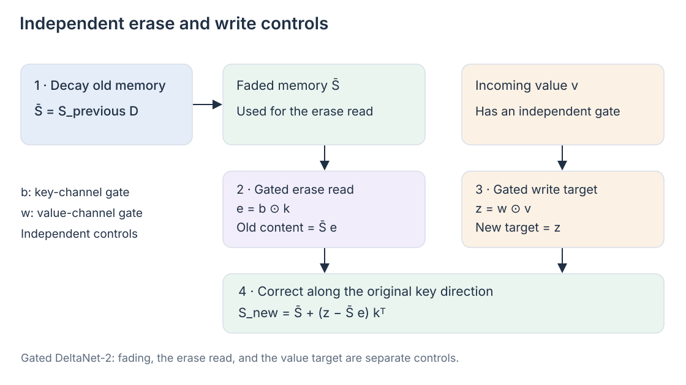
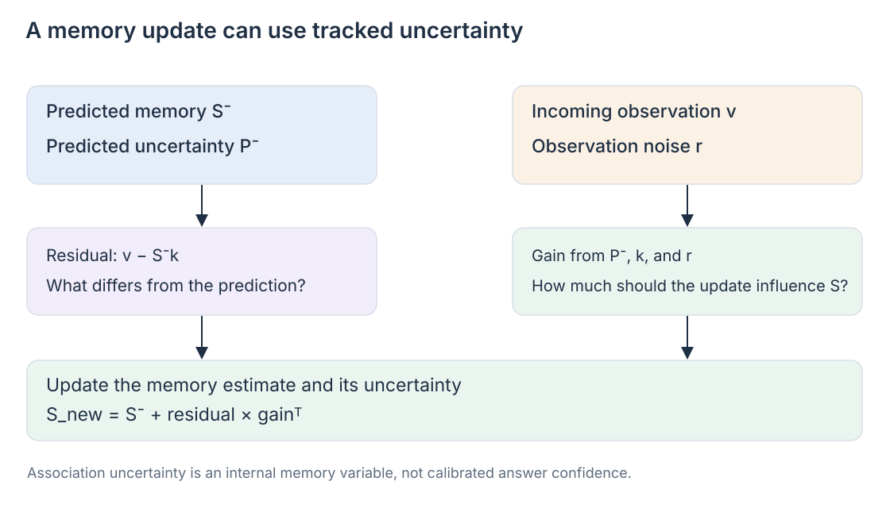

# 10 · Finer memory control and the questions that remain

The correction for order **7314** exposes more than a retrieval problem. The assistant must decide which old association to remove, how much new information to write, and how to handle an unreliable update. KDA gives different channels different lifetimes, but still couples parts of the active edit through one scalar delta strength.

Recent work opens those controls further. This chapter covers the 2026 research in PDF pages 28–31 and turns it into practical design questions. The [reference note](../bibliography/reference-note.md) records the article's role; publication dates and experimental scope below refer to primary papers available by **10 October 2026**. These studies should be distinguished from the released hybrid architectures in the previous chapter.

## Fine-grained writing: FG²-GDN and its “+” variant

KDA's decay \(D_t\) is channel wise, but its delta strength \(\beta_t\) is scalar. FG²-GDN makes the edit more selective through channel-wise scaling. In the equal-width case \(d_k=d_v=d\), define

\[
\tilde k_t=\sqrt{\boldsymbol\beta_t}\odot k_t,
\qquad \tilde v_t=\sqrt{\boldsymbol\beta_t}\odot v_t.
\]

Using our column-state convention, the base update is

\[
\bar S_t=S_{t-1}D_t,
\qquad S_t=\bar S_t(I-\tilde k_t\tilde k_t^\top)
+\tilde v_t\tilde k_t^\top.
\]

The same scaling vector affects key and value channels. This preserves a tied, symmetric rank-one correction in key space; it is more specific than freely assigning an arbitrary learning rate to every matrix entry. FG²-GDN+ introduces separate key and value scaling vectors, retaining the key-side factor in the write term while independently scaling its value side. [FG²-GDN, §§3.2–3.4](https://arxiv.org/html/2604.19021v3)

The analogy with adaptive optimization is useful: dimensions can respond differently to the same token. These gates are predicted by the model; they are not automatically Adam-style statistics of past gradients. For order 7314, a correction could strongly change a delivery-related direction while weakly changing another feature. Whether training learns such specialization needs evidence.

**Research scope:** the April 2026 paper, revised in August, evaluates 340M/15B-token and 1.3B/100B-token models using matched 3:1 recurrent/MLA hybrids. Each configuration is trained once. Its comparison tests a memory-cell change within that setting, not universal superiority across scales and architectures. [Experimental setup and limitations](https://arxiv.org/html/2604.19021v3)

## Separate the erase read from the write target

Gated DeltaNet-2 gives the key-side erase and value-side write independent channel gates. Let \(b_t\in\mathbb R^{d_k}\), \(w_t\in\mathbb R^{d_v}\). Its operation can be written compactly as

\[
\bar S_t=S_{t-1}D_t,
\quad e_t=b_t\odot k_t,
\quad z_t=w_t\odot v_t,
\]

\[
S_t=\bar S_t+(z_t-\bar S_te_t)k_t^\top.
\]

The erased prediction is read through \(e_t\); the new target is scaled separately through \(z_t\). Both corrections are written along \(k_t\). This is not merely two names for the same scalar. Setting both gates to a shared scalar \(\beta_t\) recovers KDA; making decay scalar as well recovers GDN. [Gated DeltaNet-2, §3](https://arxiv.org/html/2605.22791v1)

The formula also shows why different “erase/write” proposals need careful comparison. FG²-GDN+ uses separate square-root key/value scaling while retaining a symmetric key correction. GDN-2 gates the erase read independently of the ungated key write direction. They pursue related goals through different parameterizations.

**Research scope:** the May 2026 GDN-2 report compares 1.3B models trained on 100B FineWeb-Edu tokens, in recurrent-only and sliding-window hybrid forms. Its reported results support those tested conditions; they do not establish adoption in a frontier-scale released model. [GDN-2, §4 and appendix](https://arxiv.org/html/2605.22791v1)

## Uncertainty about a stored association

An incoming correction can be useful or noisy. Suppose Friday came from a confirmed dispatch update, whereas Tuesday came from an early estimate. A token-derived gate can learn distinctions from the representation, but does not explicitly track how much evidence already supports the stored association.

Kalman Delta Networks maintain uncertainty alongside memory. Their linear-Gaussian formulation derives a correction from a prediction residual and a Kalman gain. In our notation, an explanatory full-covariance step is

\[
\kappa_t=\frac{P_t^-k_t}{r_t+k_t^\top P_t^-k_t},
\qquad
S_t=S_t^-+(v_t-S_t^-k_t)\kappa_t^\top.
\]

Here \(P_t^-\) describes predictive uncertainty in key-space associations, \(r_t\) describes observation noise, and \(S_t^-\) is predicted memory. Greater uncertainty or more reliable evidence can increase the update's influence. The full covariance recursion is expensive; the paper develops diagonal and isotropic retained approximations with uncertainty state per key channel or per head. [KDN, §§3–4](https://arxiv.org/html/2609.07816v2)

This uncertainty is an internal state-space quantity. It is not the assistant's probability that its final answer is correct, and should not be displayed as a calibrated customer-facing confidence score without separate validation.

**Research scope:** the September report includes recurrent-only pretraining at 750M/50B tokens and 1.3B/100B tokens, plus 1.3B hybrids alternating nine recurrent layers with nine 2K-window attention layers. The diagonal/isotropic approximations make the proposal computationally practical while changing the full filter. Their empirical advantages remain findings from these controlled experiments. [KDN, §5 and Appendix A.1](https://arxiv.org/html/2609.07816v2)

## Evaluate the memory, then the complete system

Cell-level retrieval tests answer narrow questions. A useful evaluation varies several factors independently:

- **Overwrite:** keep the same order ID, revise Tuesday to Friday, then ask for the current day.
- **Interference:** add similar order IDs and conflicting values, not only unrelated filler.
- **Retention:** move the correction further from the final query and vary the number of intervening associations.
- **Evidence access:** ask for the correction's source or exact wording, rather than only its summarized value.
- **Uncertainty:** vary reliability and contradictory observations, and test calibration separately from recall.
- **System cost:** measure batch size, prefill, decode, total cache, state precision, and kernel implementation with comparable quality.

These tests reveal different failures. Correctly remembering Friday does not demonstrate verbatim recall. A fast recurrent kernel does not establish a faster whole hybrid. Parameter matching does not ensure identical optimization quality; report training data, tokens, and tuning alongside model size.

Learning where to retain information—recurrent state, per-position records or pooled records—and which retained records to read is a plausible further direction. Storage allocation and sparse retrieval are separate decisions; a learned controller could coordinate them. Treat this as a design hypothesis. Demonstrated mechanisms already provide finer editing, channel lifetimes, and uncertainty-aware gains; an automatic allocator would additionally need to learn which information deserves each storage path under a budget. The evidence required is both behavioral and operational: better order handling at a measured cost, across realistic revisions and retrieval demands.
