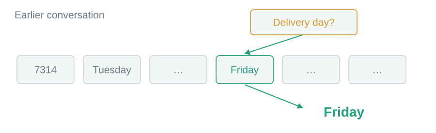
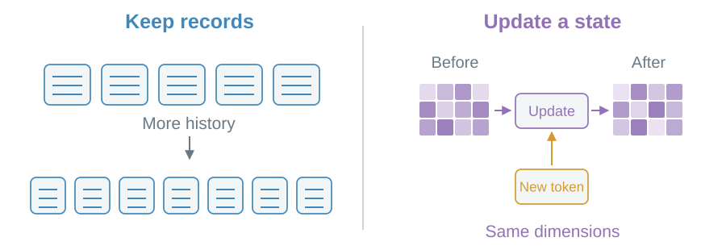
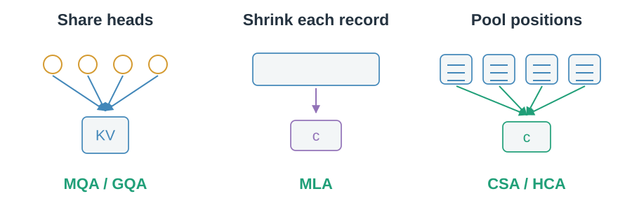

# 00 · The whole map

Find useful context. Keep it affordable.

## Which delivery day is current?

Tuesday was corrected to Friday. A useful read must find the correction.

> Attention gives a query access to relevant context.

## Must history stay as separate records?

Keep a growing collection of records, or continually update an aggregate state.

> At fixed model size, recurrent decode state has fixed dimensions.

## What can we make smaller?

Within the record route, change sharing, record width or record count.

> GQA and MLA name designs. Sequence compression names an operation; recurrent attention names a family.

Sketches stand for learned vectors, not literal database fields. Both retrieval and retention can fail. Continue with [the basic read](01-addressable-attention.md).
