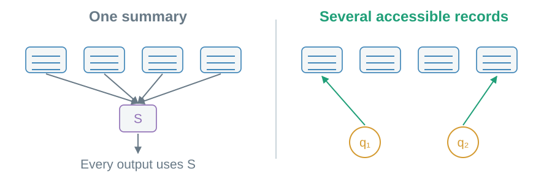
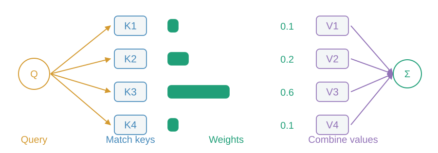
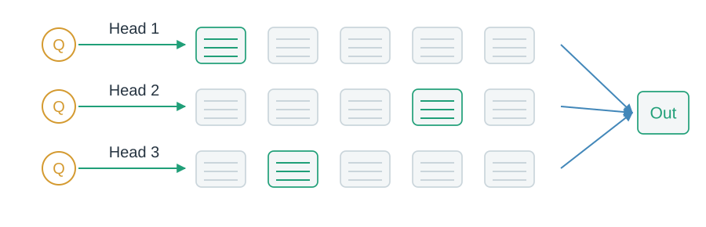
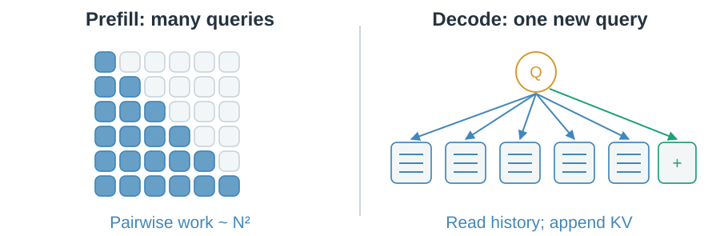

# 01 · Find the right context

Different outputs need different parts of the input.

## Why keep several records?

A single summary must serve every output. Attention lets each output consult different positions.

> Keep context accessible, then choose the read.

## What do Q, K and V do?

Query Q asks. Keys K provide matching features. Values V supply the content being combined.

> Match keys → normalize scores → combine values. The weights shown are illustrative.

## Why several heads?

Heads learn different matching spaces over the same context. Their readouts are combined.

> Multiple learned views; no permanently assigned head roles.

## Why does long context cost more?

Prefill handles the prompt. Cached decode appends one position and reads the retained history.

> Causal visibility excludes future positions; positional information helps represent order.

The records remain available, but correct retrieval is learned. Next: [share their KV](02-kv-sharing.md).
