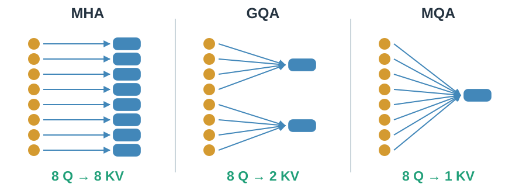
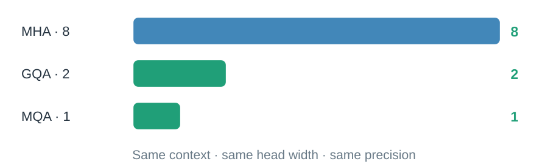
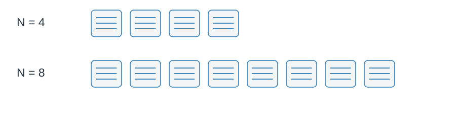

# 02 · Share the KV cache

Many query heads do not always need separate stored keys and values.

## Can heads share stored history?

MHA keeps separate KV heads. GQA shares within groups. MQA shares one KV head across all queries.

> Queries still differ, so their attention weights can differ.

## How much storage changes?

Hold context, head dimensions and precision fixed. KV elements scale with KV head count.

> Fewer KV views save cache space, with a representation-sharing tradeoff.

## What still grows?

Every retained position still needs its record.

> A smaller cache is not automatically an equal reduction in total latency.

Sharing must be learned or adapted into the model. Next: [make each record compact](03-latent-kv.md).
