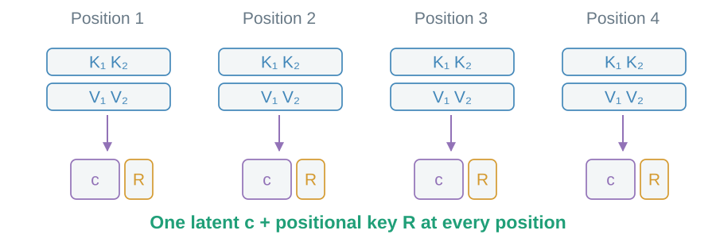
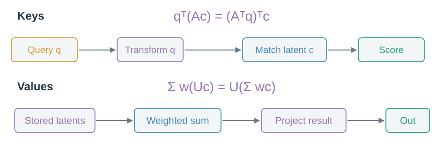
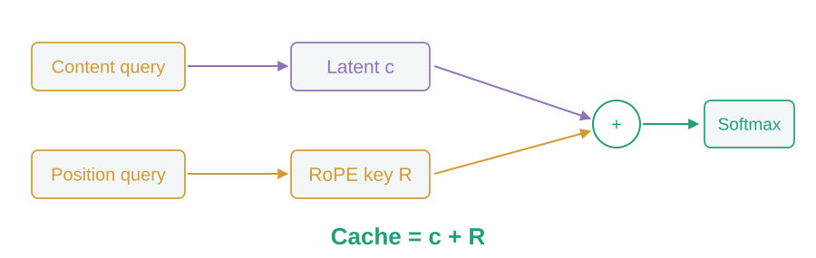

# 03 · Smaller records: MLA

Can one learned latent support the content keys and values of several heads?

## What stays in the cache?

MLA stores a compact latent c and a separate positional key R at each historical position.

> Shrink each position’s representation; keep positions separately addressable.

## Why avoid expanding every past record?

Move content projections to the current query and output sides. Each head still forms its own weighted read.

> Projection absorption is equivalent algebra for the learned MLA parameterization.

## What about position?

RoPE rotates query and key coordinates according to position. Positional matching therefore keeps its own path.

> Cache the latent plus the positional key. More positions still mean more records.

The remaining options are to [read fewer records](06-sparse-retrieval.md), [pool positions](07-sequence-compression.md), or [use recurrent state](04-recurrent-memory.md).
