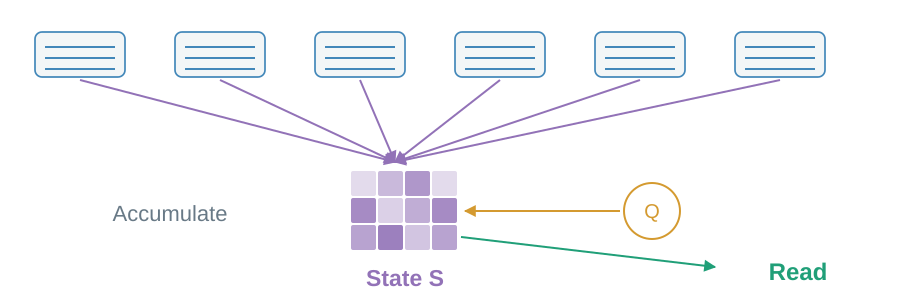
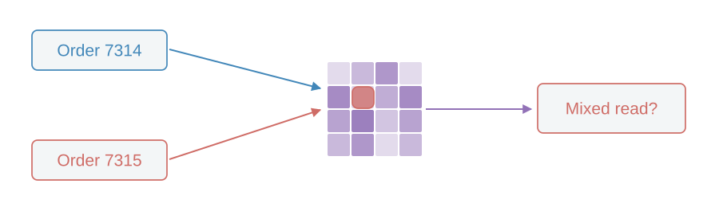
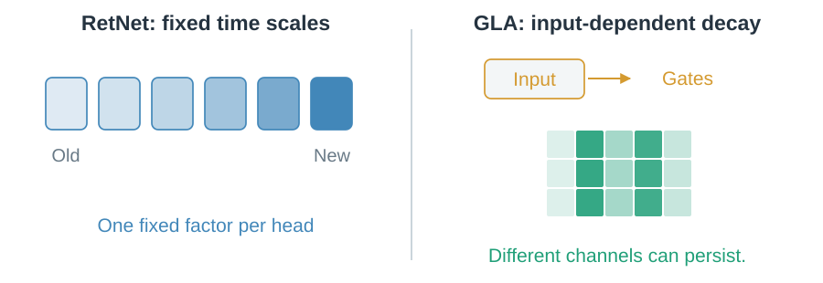

# 04 · Keep a working state

Can useful history survive without a record for every old position?

## Can many writes become one state?

Kernel linear attention changes the matching rule so key–value contributions can accumulate in a matrix. Normalized forms also keep a normalizer.

> The carried state stays fixed in size at fixed model dimensions.

## What is the price?

Several associations share state coordinates. Similar keys can interfere.

> Fixed dimensions mean finite capacity, not unlimited memory.

## Can old information fade?

RetNet uses fixed retention time scales. GLA learns input-dependent forgetting.

> Forgetting frees capacity; an additive write still does not explicitly replace an association.

Mamba and Mamba-2 reach recurrent state through state-space models. Next: [correct an association](05-delta-memory.md).
