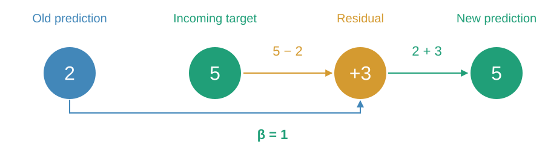
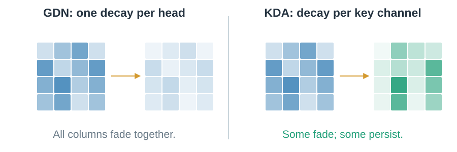

# 05 · Correct the memory

Adding another observation and correcting an old association are different operations.

## What should a correction write?

Read the old prediction. Compare it with the incoming value. Write the residual.

> Toy example: a unit key, Tuesday = 2, Friday = 5. A full delta edit writes +3.

<!-- delta-demo -->

## What if old information should fade too?

Gated DeltaNet fades the state, then corrects the prediction read from that faded state.

![Toy Gated DeltaNet: scalar decay 0.5 changes state [2,4] to [1,2]. Reading the faded first key gives residual 5-1=4; a full delta correction gives [5,2].](../figures/visual/05-fade-correct.svg)

> Forget first, then correct. The order changes the result.

## Must every channel fade equally?

GDN uses scalar decay per head. KDA gives key channels their own decay rates.

> Some directions can persist while others fade. Learned directions may still overlap.

Gates and keys are learned representations. Targeted editing still has finite capacity. Next: [combine state with historical records](08-hybrid-memory.md).
