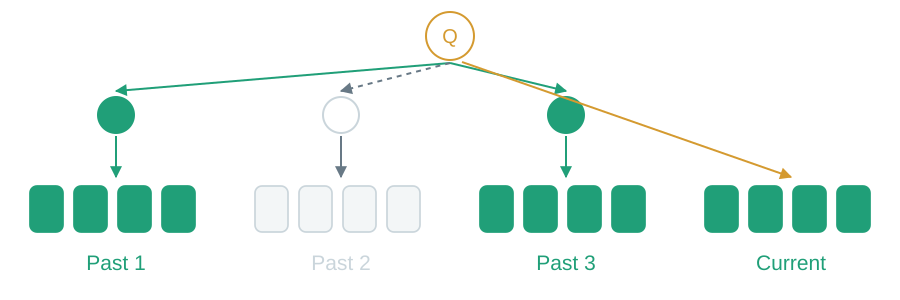
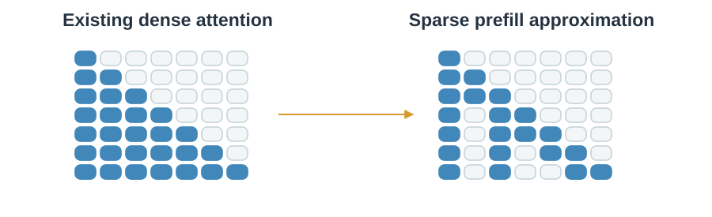
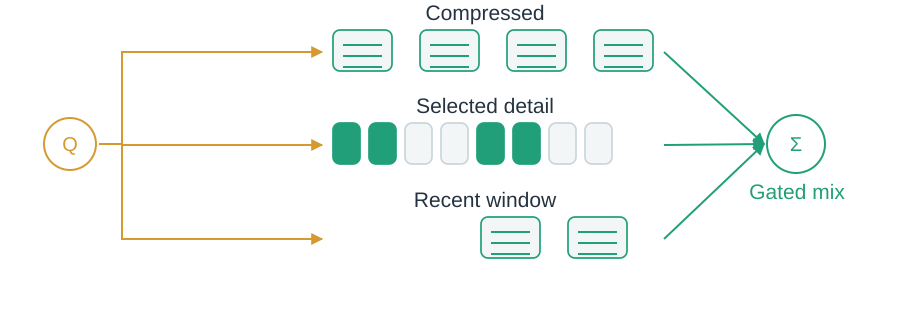
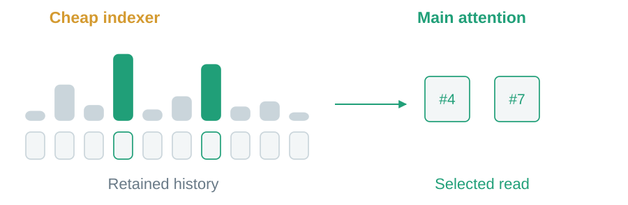

# 06 · Choose what to read

Keep history available. Spend the expensive read on selected entries.

## Can we prescribe the connections?

Longformer combines local and global links. BigBird also adds random links.

> Connectivity sketch with causal visibility shown; the original document models also use bidirectional forms.

## Can the query choose blocks?

MoBA scores mean-key summaries, then reads original entries inside selected blocks. The current block stays causally available.

> A routing summary chooses access; it is not the detailed value read.

## Can an existing model use sparse prefill?

MInference approximates its reads with suitable sparse head patterns, without model retraining.

> An inference approximation changes access; quality needs checking.

## Can summaries and detail cooperate?

NSA trains compressed, selected-detail and local branches together. Gates mix their outputs.

> Selectable original history remains stored alongside the summaries.

## Can selection be cheaper than the main read?

DSA uses a lightweight indexer to choose entries. DeepSeek-V3.2 combines it with MLA.

> The indexer still scores growing history; its work is quadratic over a complete sequence.

**Sparse reads do not imply cache eviction.** Next: [reduce how many records exist](07-sequence-compression.md).
