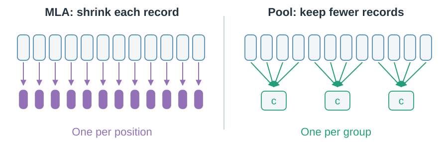
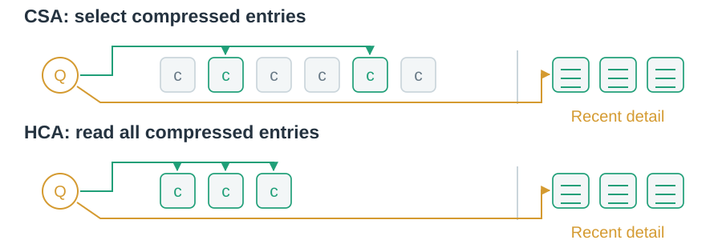
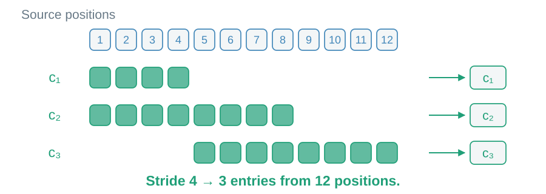

# 07 · Keep fewer records

Small records can still become a very long list.

## Can several positions share one record?

Sequence compression pools positions. MLA instead keeps a compact record per position.

> A shorter record sequence still grows; it is not fixed recurrent state.

## How should compressed history be read?

CSA selects moderately compressed entries. HCA reads all eligible heavily compressed entries. Both also read recent uncompressed positions in the same core read.

> V4 pairs pooling with shared-KV MQA, where entries serve as both key and value.

## Does overlap halve record count again?

CSA windows overlap, but a new entry is emitted at each stride. HCA uses stronger, non-overlapping pooling.

> Pooling can lose detail. A recent correction depends on compressed history after leaving the local window.

Dense reads of the compressed sequence remain quadratic at fixed ratios, with a smaller coefficient. Next: [combine memory organizations](08-hybrid-memory.md).
