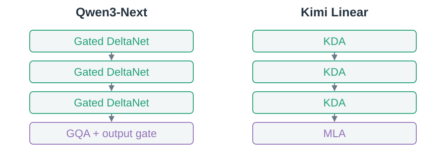
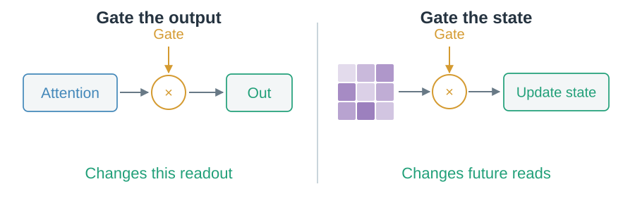
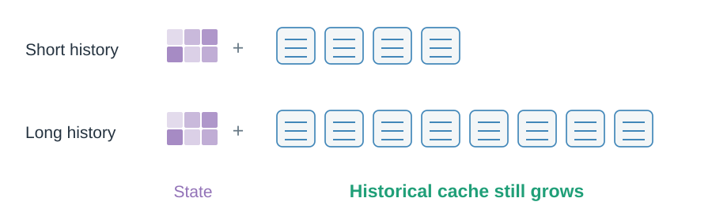

# 08 · Use both kinds of memory

A compact state can maintain context. Historical records can supply detail that the state lost.

## Why combine layers?

Qwen3-Next and Kimi Linear both repeat three recurrent layers followed by one explicit-attention layer. Their component mechanisms differ.

> This is a model design: state layers plus record-based layers.

## Where does a gate act?

An output gate scales a computed readout. A state gate changes memory carried to later tokens.

> Output suppression does not imply the attention read was skipped.

## Is the whole hybrid fixed-memory?

The state component stays bounded; explicit layers retain growing historical caches.

> Fewer explicit layers reduce the growing term. They do not remove it.

Layer composition, record representation and sparse selection are separate choices. Next: [execute and store them efficiently](09-execution-and-storage.md).
