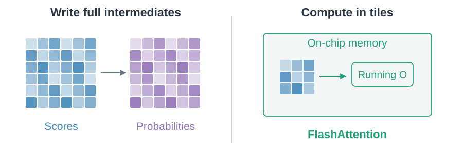
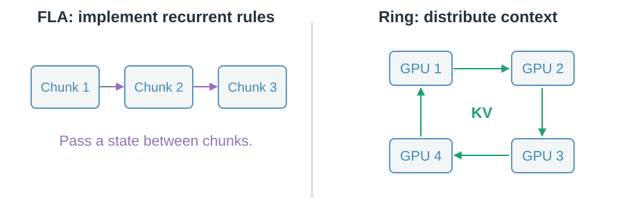
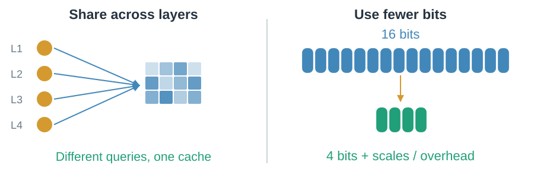
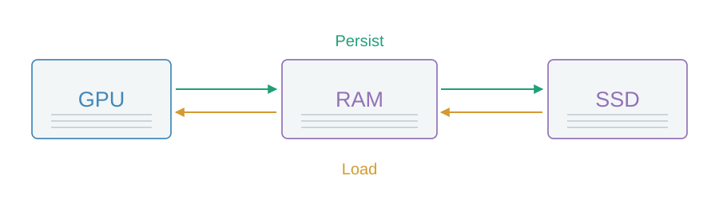

# 09 · Move and store fewer bytes

Cache capacity, data traffic and arithmetic are different costs.

## Must attention write full score matrices?

FlashAttention works in tiles and maintains running softmax statistics and output.

> The dense read is preserved, subject to numerical differences. Pairwise arithmetic remains quadratic.

## Can execution suit the hardware?

FLA implements multiple recurrent rules efficiently. Ring Attention circulates KV blocks across devices.

> An implementation library and a distributed schedule solve different execution problems.

## Can the same information occupy less space?

Cross-layer reuse shares cache sets. Quantization lowers stored precision, with numerical and metadata costs.

> Storage savings alone do not determine read traffic or latency.

## Can computed prefixes be reused?

Paged storage reduces fragmentation. Compatible prefix computations can persist on GPU, in host RAM or on SSD.

> Reuse can save recomputation; moving cached prefixes still costs time.

Persistent computed cache is not automatically lifelong semantic memory. Next: [finer state control](10-frontier-and-design.md).
