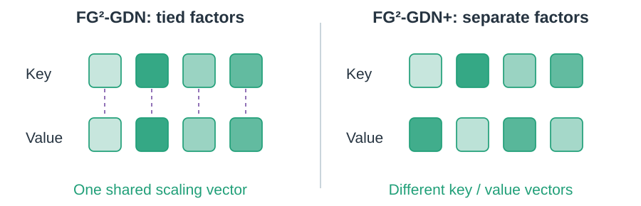
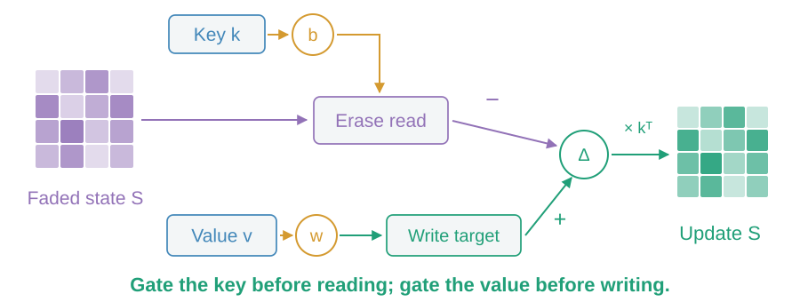
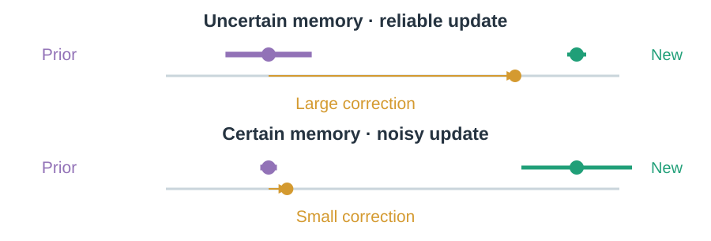
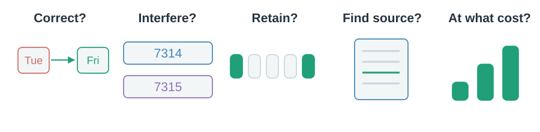

# 10 · Control the next update

Research asks what to erase, what to write, and how strongly to trust a new observation.

## Can update strength vary by channel?

FG²-GDN ties key and value scaling. Its “+” variant separates the scaling factors.

> Finer factors give selective control through a specific update rule.

## Can erasing and writing be controlled separately?

Gated DeltaNet-2 separately gates the erase read and the incoming write target.

> Related goals can use different algebra; FG²-GDN+ and GDN-2 are distinct rules.

## Should accumulated uncertainty matter?

Kalman Delta Networks track memory uncertainty and observation reliability to influence the correction gain.

> Internal memory uncertainty is not automatically confidence in the final answer.

## What would count as progress?

Test the behavior you need, then measure the whole system.

> Remembering a revised fact, retrieving its evidence and running efficiently require different tests.

These are research proposals with controlled experimental evidence. Use the [mechanism matrix](../appendices/mechanism-matrix.md) to reconnect the whole map.
